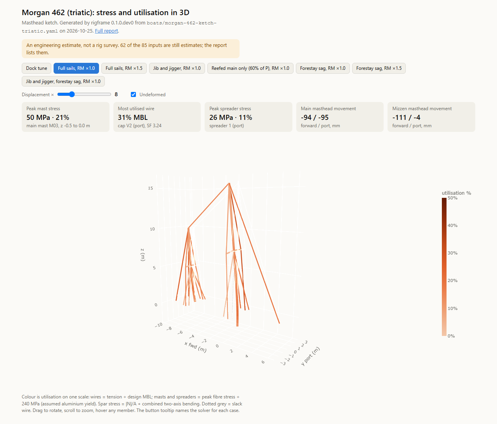
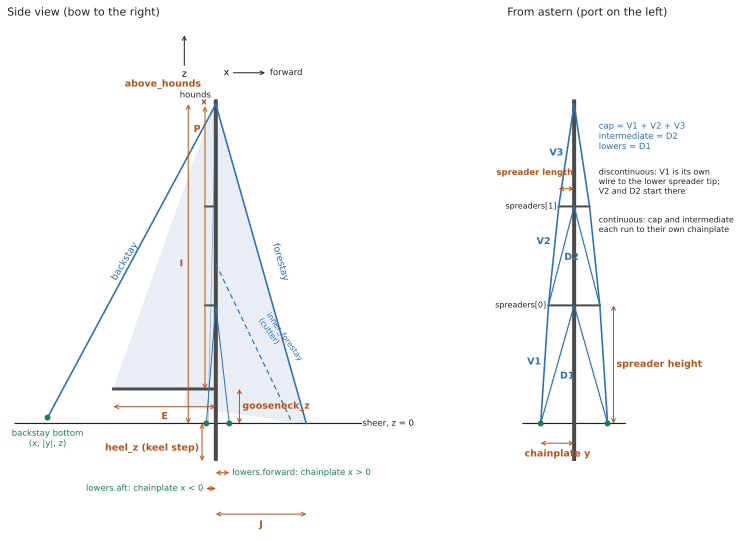

# rigframe

**A sailboat's standing rig, analysed as a 3D frame, from one short text file.**

You describe your boat's rig in a short text file: the sail plan, the mast, the spreaders, and where each
wire goes. rigframe tunes the rig at the dock, sails it through a set of load cases, and writes a report
you can share with the owner, the rigger or the surveyor:

- a **rigging list**: every wire, its size, length, breaking load, dock tension and highest load;
- each **load case** item by item: every wire segment's tension and safety factor, the mast and spreader
  stresses, the chainplate loads, how far the mast bends;
- **buckling** of the mast;
- figures for every case;
- an **interactive 3D viewer**: pick a load case, turn the rig around, and hover over any wire or spar to
  see its load, its safety factor and how hard it's working;
- on the first page, **every input that is still an estimate**, so you know what to measure.



<sub>The 3D viewer on the Morgan 462 example (placeholder rig): full sail at RM ×1.0, every member coloured by
how close it is to its limit. Drawn with plotly.js (MIT).</sub>

**You don't need to code, install anything, or have used GitHub before.** An AI assistant can draft the file
for you, and the rest happens in your web browser: you paste the file into GitHub's website and GitHub runs
the analysis. If GitHub is new to you, [start here](#start-here).

> **Status: draft, in demo mode.** The boat file, its checker, the example boats, the 3D viewer and the GitHub
> workflow all work. The analysis engine is still being moved out of the notebooks it was developed in. Until it
> lands, a boat file you send in is checked and gets a report of its estimates, marked **DEMO**. For the four
> example boats the viewer also replays the notebook studies' stored results; those don't change if you edit the
> file. **For the full analysis today, use [the notebooks](#the-notebooks-the-full-analysis-today)**, which also
> run in your browser.

> **This is an engineering estimate, not a rig survey.** It assumes the rig is in good condition, and it
> knows nothing about corrosion, fatigue, cracked swages or worn chainplates. Have a rigger inspect the
> rig. The report says which numbers are estimates; treat them that way.

---

## Contents

- [Start here](#start-here)
- [Four ways to get a report](#four-ways-to-get-a-report)
- [The notebooks: the full analysis today](#the-notebooks-the-full-analysis-today)
- [Step 1: Make your boat file](#step-1-make-your-boat-file)
- [Step 2: Open a pull request with your file](#step-2-open-a-pull-request-with-your-file)
- [Step 3: Read the report](#step-3-read-the-report)
- [Keeping your boat private](#keeping-your-boat-private)
- [Running it on your own computer](#running-it-on-your-own-computer)
- [What runs where](#what-runs-where)
- [How it works](#how-it-works)
- [Adding to rigframe](#adding-to-rigframe)
- [Licences and credits](#licences-and-credits)

---

## Start here

Pick what you want to do. None of it needs you to write code.

| You want to | Do this | You need |
|---|---|---|
| **See what rigframe makes** | Open the [example boats](https://rigframe.github.io/rigframe/#boats) and click **Open the 3D viewer**, or download a finished report from the [sample reports](https://github.com/rigframe/rigframe/releases/tag/sample-reports) | Nothing: no account, no install |
| **Get a report for your boat** | [Step 1](#step-1-make-your-boat-file): an AI assistant drafts your boat file. [Step 2](#step-2-open-a-pull-request-with-your-file): paste it into GitHub's website. [Step 3](#step-3-read-the-report): read the report | A free GitHub account and a web browser |
| **Keep your boat private** | The same steps, in [your own private copy](#keeping-your-boat-private) | A free GitHub account |
| **Run the full analysis today** | Open [a notebook in Google Colab](#in-google-colab-nothing-to-install) and click **Run all** | A free Google account |

The whole of Step 1 and Step 2 takes about half an hour the first time, most of it answering the AI
assistant's questions about your boat.

### Words you'll meet

- **GitHub** is the website this project lives on. A free account lets you send it files.
- **Repository** (or *repo*): a project's folder on GitHub. This page is the front of the rigframe repository.
- **Boat file**: the short text file that describes your rig. It's written in **YAML**, a plain-text format of
  `name: value` lines. You can read it like a list, and edit it in any text editor or straight on GitHub's
  website.
- **Pull request**: how you offer a file to a repository you don't own. It's a request, not a change: nothing
  in rigframe changes unless a maintainer accepts it, and you can close it at any time.
- **Fork**: your own copy of the repository. GitHub makes it for you during a pull request, and you don't need
  to do anything with it.
- **Check**: the program GitHub runs on your file when you open a pull request (*GitHub Actions* runs it). Here
  it checks your file and writes your report.
- **Artifact**: a zip file of results that a check leaves for you to download.
- **Notebook**: a document that mixes explanation, code and results. You run it top to bottom; you don't need
  to read the code.
- **Google Colab**: Google's free service that runs notebooks in your web browser.

### You can't break anything

Nothing you do from these pages changes rigframe or anyone else's files. A pull request only proposes your
file. A notebook in Colab runs on Google's computers, in a copy that's yours alone. If something goes wrong,
close the pull request or the browser tab and start again.

**Stuck?** Ask. Write a comment on your pull request, or open an issue: the **Issues** tab at the top of this
repository, then **New issue** (you need to be signed in). Say what you tried and paste any error message.
Questions from people new to GitHub are welcome.

---

## Four ways to get a report

| | What you need | Do you write code? | Who sees your boat | What you get today |
|---|---|---|---|---|
| **[A pull request](#step-2-open-a-pull-request-with-your-file)** to this repository | A free GitHub account and a web browser | No | Everyone: this repository is public | Demo report and 3D viewer |
| **[Your own private copy](#keeping-your-boat-private)** | A free GitHub account and a web browser | No | Only you, and anyone you invite | Demo report and 3D viewer |
| **[A notebook](#the-notebooks-the-full-analysis-today)**, in Colab or on your computer | A web browser and a free Google account (Colab), or Python 3.12 | No: you change numbers in one cell and click Run all | Only you | The full analysis and the 11 × 17 report |
| **[Your own computer](#running-it-on-your-own-computer)**, with the package | Python 3.12 or later | A few typed commands | Only you | Demo report and 3D viewer |

The pull request, the private copy and your own computer all start from a boat file, and the first two happen
entirely on GitHub's website. The notebooks are separate: each holds one boat's whole analysis, and you edit its
inputs in one cell. Until the analysis engine moves into the package, the notebooks are the only way to get the
full analysis.

---

## The notebooks: the full analysis today

[`notebooks/`](notebooks/) holds the three studies the method was built and checked on. Each runs on its own: it
needs neither GitHub Actions nor the rigframe package. Each one tunes the rig at the dock, sails it through every
load case, checks mast buckling, and cross-checks the main cases in a second solver. It ends in a table of 30 to 53
PASS/FAIL checks.

| Notebook | Rig | Open |
|---|---|---|
| [`beneteau-oceanis-440-1994`](notebooks/beneteau-oceanis-440-1994.ipynb) | Masthead sloop, two sets of swept spreaders, discontinuous shrouds, four lowers, split backstay, in-mast furler | [](https://colab.research.google.com/github/RigFrame/rigframe/blob/main/notebooks/beneteau-oceanis-440-1994.ipynb) |
| [`island-packet-40-1996`](notebooks/island-packet-40-1996.ipynb) | Masthead cutter: one spreader set, fore and aft lowers, staysail stay, twin backstay | [](https://colab.research.google.com/github/RigFrame/rigframe/blob/main/notebooks/island-packet-40-1996.ipynb) |
| [`morgan-462-ketch`](notebooks/morgan-462-ketch.ipynb) | Masthead ketch, two masts, run with a triatic and with split backstays | [](https://colab.research.google.com/github/RigFrame/rigframe/blob/main/notebooks/morgan-462-ketch.ipynb) |

**Just want to see the result?** The [sample-reports release](https://github.com/rigframe/rigframe/releases/tag/sample-reports)
has the finished PDFs for all three boats. Click a file name to download it; nothing to run.
- `*-report.pdf`, written by the notebooks;
- `*-companion.pdf`, the method behind each study: every load case with free-body diagrams, how each sail load is
  applied, the terms, and the textbook equations by number and page.

### In Google Colab, nothing to install

1. Click **Open in Colab** next to the boat you want. The notebook opens in a new tab. Sign in to Google if it
   asks.
2. In Colab's menu, click **Runtime**, then **Run all**.
3. Colab warns that the notebook wasn't written by Google. Click **Run anyway**. (It comes from this repository,
   and you can read every line of it first.)
4. Wait. The first cells fetch this repository and add what Colab lacks, in about a minute. The analysis takes a
   few minutes more. A cell that's still running has a spinning circle at its left.
5. If a cell asks you to restart, click **Runtime**, then **Restart session**, then **Runtime**, then **Run all**
   again. The install cell asks only when it can't avoid replacing a package Colab has already loaded.
6. Scroll down to read the results. The last table lists every check and whether it passed.
7. **To keep the report,** click the folder icon on Colab's left edge and open `rigframe`, then `notebooks`, then
   `output`, then the boat's folder. Hover over a file, click its **⋮** menu, then **Download**. `viewer-3d.html`
   is the 3D viewer; it opens in any browser, offline. Download before you close the tab: Colab deletes the files
   when the session ends.

Colab runs a newer Python than 3.12. If OpenSees won't load there, the cross-check reports SKIP and the rest runs.

### Your own boat in a notebook

1. Open the notebook nearest your rig in Colab, as above.
2. Click **File**, then **Save a copy in Drive**, and work in the copy. Colab doesn't keep changes to the
   original.
3. Find the cell that starts `class RigParams`. Every input is there, one per line, with a note after the `#`
   saying what it is. Lines marked `# PLACEHOLDER` are estimates.
4. Change the numbers, and only the numbers. `* FT` after a number means feet and `* IN` inches; a number with
   neither is in metres (or the unit the note gives). Leave the commas, brackets and quote marks as they are.
5. Click **Runtime**, then **Run all**.

### On your computer, if you use Python

With Python 3.12, from the `notebooks/` folder:

```bash
python -m venv .venv
```

Activate it (`.venv\Scripts\activate` on Windows, `source .venv/bin/activate` elsewhere), then:

```bash
pip install -r requirements.txt
```

Open the notebook in Jupyter or VS Code and run it. Python 3.12 matters only for the OpenSees cross-check: its
Windows build needs exactly 3.12. Without OpenSees those checks report SKIP and everything else runs.

**What a run writes,** in `notebooks/output/<notebook>/`:
- `REPORT.md`, every load case item by item, with its figures in `assets/`;
- `viewer-3d.html`, the standalone 3D viewer.

To turn the report into an 11 × 17 in PDF:

```bash
python tools/md_to_tabloid_pdf.py notebooks/output/island-packet-40-1996/REPORT.md
```

LaTeX typesets it, in CMU Serif (Computer Modern) with proper math. That needs
[pandoc](https://pandoc.org/installing.html), a TeX distribution with XeLaTeX and the CMU fonts, and `rsvg-convert`
for the figures:
- **Windows:** [MiKTeX](https://miktex.org/) installs the fonts on demand.
- **Ubuntu:** `sudo apt install pandoc texlive-xetex texlive-latex-extra texlive-science lmodern fonts-cmu librsvg2-bin`.

Without LaTeX, add `--engine chromium` to print it with a browser instead (`pip install playwright`, then
`playwright install chromium` once).

GitHub Actions rebuilds the sample reports whenever a notebook, a companion or the PDF tool changes: it runs the
three notebooks, typesets the PDFs and replaces them on the release. The companions were written by hand for these
three boats; their source is in [`docs/companions/`](docs/companions/).

---

## Step 1: Make your boat file

The boat file says what your rig is and where each number came from. Getting the numbers together is
the hard part, so there are two ways in.

### The easy way: have an AI assistant draft it

[`prompts/make-boat-yaml.md`](prompts/make-boat-yaml.md) is a prompt you paste into an AI assistant with
web search turned on (Claude, ChatGPT, Gemini or similar). It reads this repository's rules, looks up
your boat's published data, asks you only what it can't find, and hands back:

- the file name to use;
- the finished YAML;
- the sources it used;
- a list of what to measure, most important first.

1. Open [the prompt](prompts/make-boat-yaml.md) and copy the text in the grey box. The copy button is at its top
   right.
2. Paste it into the AI assistant as your first message.
3. Answer its questions. "Don't know" is a fine answer. Attach photos when it asks: the rig from the side and
   from astern, each chainplate, the label at the mast foot. They settle questions no website answers.
4. When it hands back the file, copy the file name and the YAML somewhere safe, such as a note or an email to
   yourself. You don't need to save it as a file: in Step 2 you paste it straight into GitHub.

Expect two or three rounds of questions and about 20 minutes. The file will have plenty of estimates in it.
That's normal: the report lists them, and you can measure them later and send the file again.

### By hand

Copy [`docs/boat-template.yaml`](docs/boat-template.yaml), or the example nearest your rig:

| Your rig | Start from |
|---|---|
| Sloop, one set of spreaders | [`docs/boat-template.yaml`](docs/boat-template.yaml) |
| Sloop, two or more sets | [`boats/beneteau-oceanis-440-1994.yaml`](boats/beneteau-oceanis-440-1994.yaml) |
| Cutter | [`boats/island-packet-40-1996.yaml`](boats/island-packet-40-1996.yaml) |
| Ketch or yawl | [`boats/morgan-462-ketch-triatic.yaml`](boats/morgan-462-ketch-triatic.yaml) or [`…-split-backstays.yaml`](boats/morgan-462-ketch-split-backstays.yaml) |

To copy one, open it, click the **Copy raw file** button (two overlapping squares, top right of the file), and
paste it into a text editor: Notepad on Windows, TextEdit on a Mac (choose **Format → Make Plain Text** first).
[`docs/boat-yaml.md`](docs/boat-yaml.md) explains every field, how to measure it and where to look it up.



### What a value looks like

```yaml
I: {value: 53.15 ft, basis: published, ref: gob}   # with its source
gooseneck_z: 1.75 m                                 # bare: counts as an estimate
```

Every number has a unit, and you keep the unit your source used. `basis` is `measured`, `maker`,
`published` or `estimate`. A file full of estimates still runs; the report just says so.

Three rules keep a YAML file working:
- **Indentation counts.** The spaces at the start of a line say what it belongs to. Use spaces, never tabs, and
  line a new entry up with its neighbours.
- **A colon is followed by a space:** `I: 53.15 ft`, not `I:53.15 ft`.
- **`#` starts a note.** Everything after it on the line is ignored, so you can write anything there.

The checker in Step 2 catches mistakes and tells you the line to fix, so don't worry about getting it perfect.

### Name the file

`<builder>-<model>-<year>.yaml`, lowercase, with hyphens: `catalina-36-1989.yaml`. To compare two
arrangements of the same boat, make two files and add the difference to the name:
`morgan-462-ketch-triatic.yaml` and `morgan-462-ketch-split-backstays.yaml`.

### Leave out anything personal

No owner's name, boat name, hull identification number, sail number or home port. A pull request here is
public. If you'd rather keep the boat itself private, see [Keeping your boat private](#keeping-your-boat-private).

---

## Step 2: Open a pull request with your file

A pull request is how you hand a file to a GitHub repository you don't own. You do it all in the
browser. GitHub makes your own copy of the repository (a *fork*) along the way, and you don't have to
manage it.

**Before you start:** you need a free GitHub account. If you don't have one, go to
[github.com/signup](https://github.com/signup), give an email address, a password and a username, and confirm
the code GitHub emails you. Then sign in.

### 2.1 Add the file

1. Go to the [`boats` folder](https://github.com/rigframe/rigframe/tree/main/boats) of this repository.
2. Click **Add file** (top right, above the file list), then either:
   - **Create new file** (easiest if you have the YAML from an AI assistant): type the file name into the box
     above the editor (the `boats/` part is already there), and paste your YAML into the editor; or
   - **Upload files**, and drag your `.yaml` file onto the page.
3. GitHub says you need your own copy to propose a change. Click **Fork this repository**. This happens
   only the first time.

### 2.2 Propose the change

4. Click **Commit changes…** (or **Propose changes** on the upload page).
5. In the box that opens, write a title such as `Add Catalina 36 (1989)`. The description can stay empty.
6. Click **Propose changes**. GitHub shows a page titled **Comparing changes**, with your file in green.
7. Click **Create pull request**.

### 2.3 Fill in the pull request

8. The description box holds a short checklist. Tick what applies, by typing an `x` between the brackets:
   `[ ]` becomes `[x]`. Say where most of the numbers came from, and confirm the file has nothing personal in it.
9. Click **Create pull request** again. That's it: your pull request is open.

### 2.4 Watch the check

At the bottom of the pull request a check called **Boat report** appears.

- **"Waiting for approval"** or **"1 workflow awaiting approval"**: GitHub holds the first pull request
  from a new contributor until a maintainer lets it run. You don't need to do anything. It usually
  happens within a day.
- **Yellow dot**: it's running. A full run takes a few minutes.
- **Red ✗**: something in the file needs fixing. Go to [2.5](#25-if-the-check-fails).
- **Green ✓**: the report is ready. Go to [2.6](#26-open-the-3d-viewer-and-the-report).

### 2.5 If the check fails

A red ✗ is normal on a first try, and easy to fix.

10. Click **Details** next to the red ✗. The log opens at the step that failed.
11. Under **Check the boat files**, the checker lists each problem in plain words, usually with the line
    to fix:

    ```text
    FAIL  boats/catalina-36-1989.yaml
          - sail_plan.I (line 30): '45 feet' needs a number, a space, then one of: mm, cm, m, in, ft.
          - masts.0.shrouds.cap (line 70): Additional properties are not allowed ('pretention' was
            unexpected) Check the spelling against docs/boat-yaml.md.
    ```

12. Fix it in the browser: in your pull request click **Files changed**, then the **⋯** menu at the right
    of your file's header, then **Edit file**. Make the change, then click **Commit changes…** and
    **Commit changes**. Leave it on the same branch; GitHub offers that by default.
13. The check runs again by itself. Repeat until it's green.

You can also paste the error into the AI assistant that drafted the file and ask it for the fix. If you're
still stuck, write a comment on the pull request and paste the error. Someone will help.

### 2.6 Open the 3D viewer and the report

There are two ways in. The first needs nothing but a click.

**Online, from the pull request.** A minute or two after the check goes green, a comment titled
**Rig report preview** appears on your pull request, posted by `github-actions`.

14. Click **Open the 3D viewer**. It opens in your browser, on a phone too.
15. Pick a load case with the buttons along the top. Drag to turn the rig, scroll or pinch to zoom, and
    hover over (or tap) any wire, mast panel or spreader to see its load. [Step 3](#the-3d-viewer) explains
    the colours.
16. **Report**, in the same comment, opens the full report (with a **PDF** link beside it once the package
    writes one).

The links work for anyone you send them to. If one shows "404", wait a minute: GitHub Pages takes a moment
to publish. The preview follows every change you push, and it's removed when the pull request closes, so
download a copy if you want to keep it.

**As a download, to keep.**

17. Click **Details** next to the green ✓, then **Summary** at the top left of the page that opens. The
    summary shows the headline: the governing wire and its safety factor in each load case, the mast's peak
    stress, the lowest buckling factor, and how many inputs are still estimates.
18. Scroll to the bottom, to **Artifacts**, and click **rig-report-<your file name>**. You get a zip file.
    GitHub keeps it for 90 days.
19. Unzip it (on Windows, right-click it and choose **Extract All**; on a Mac, double-click it) and
    double-click **`viewer.html`**. It opens in your browser and works **without internet**, so you can show
    it to someone on the dock. The zip also holds `REPORT.html`, the figures, `viewer.json` (the results as
    data) and a copy of your boat file.

You can share the zip, or `viewer.html` on its own, with anyone.

### 2.7 What happens next

- **You only wanted the report:** close the pull request (the **Close pull request** button at the bottom).
  Your report is already downloaded.
- **You'd like the boat to stay here as an example for others:** leave it open and say so in a comment.
  The maintainer may ask a question or two, then merge it. A merged boat gets a permanent page: its 3D
  viewer at `https://rigframe.github.io/rigframe/boats/<file name>/viewer.html`, and its report beside it.
  [The front page](https://rigframe.github.io/rigframe/) lists every published boat. The pages update
  whenever rigframe improves.
- **You measured more later:** edit the file in your pull request (step 12) and the report runs again.
  If the pull request is already closed or merged, open a new one the same way.

---

## Step 3: Read the report

The report opens with the things to check first:

1. **Estimates.** Every input still marked `estimate`, most influential first. Until those are measured,
   the numbers that depend on them are estimates too.
2. **Rigging list.** Every wire with its size, length, breaking load, dock tension and highest load.
   The lengths run pin to pin on the model's geometry; they aren't cut lengths.
3. **All cases at a glance.** One row per load case: the governing wire and its safety factor, the mast's
   peak stress and utilisation, the buckling factor.

Then each load case in full, and the method: what each case means, how the sail loads are applied, the
textbook equations behind it, and the cross-check against a second solver.

### The 3D viewer

- **Colour is utilisation**, on one scale for everything: a wire's tension as a share of its breaking load,
  and a spar's peak stress as a share of the aluminium's yield. Pale is lightly loaded; dark brown is at or
  past 50%. A dotted grey wire is slack.
- **The cards** above the view give the case's peak mast stress, the most-loaded wire and its safety
  factor, the peak spreader stress, and how far each masthead moves.
- **The shape is exaggerated.** The *Displacement ×* slider sets by how much (8 times by default). Tick
  *Undeformed* to see the rig at rest behind it.
- **Hover** shows each member's numbers: tension, safety factor and wire stress for a wire; peak stress,
  axial load and bending moments for a spar. The tooltip on each case button names the solver that ran it.

### Safety factor

**Safety factor** here is the wire's minimum breaking load over its tension in that case. It has to cover
everything the model leaves out: gusts beyond the case, wave slamming, fatigue, worn fittings. Shigley's
*Mechanical Engineering Design* asks for at least 3.5 on guy wires (Table 17-25). The report explains
what each case's factor means.

---

## Keeping your boat private

If you'd rather nobody else saw your boat file or report, run rigframe in your own private copy of the
repository. It's no harder than a pull request, and there's no waiting for approval.

1. On this repository's page, click **Use this template** (top right), then **Create a new repository**.
2. Give it a name, choose **Private**, and click **Create repository**.
3. In your new repository, add your boat file to `boats/` exactly as in [2.1](#21-add-the-file). When you
   click **Commit changes…**, leave it on **Commit directly to the main branch** (there's nothing to fork).
4. Open the **Actions** tab. The **Boat report** run appears within a minute. When it's green, open it
   and download the report from **Artifacts**, as in [2.6](#26-open-the-3d-viewer-and-the-report).
   `viewer.html` in the zip is the full 3D viewer and needs no internet.

GitHub's free plan includes Actions minutes for private repositories, and one report takes a few of
them. Private repositories can't publish GitHub Pages on the free plan, so there's no online preview and
the report comes only as a download.

---

## Running it on your own computer

This route is for people at home on a command line. Everything it does, the pull request does in the browser.
`pipx install rigframe` will work once rigframe is released.

```bash
pipx install rigframe
```

```bash
rigframe validate boats/my-boat.yaml
```

```bash
rigframe run boats/my-boat.yaml --out reports/
```

`validate` checks the file in under a second. `run` writes the report folder, with `viewer.html` in it.
The viewer carries its own copy of plotly.js (about 5 MB), so it opens offline. To rebuild it as a 50 kB file
that fetches plotly.js from the internet instead, for a web page or an email, run
`rigframe viewer reports/my-boat/viewer.json viewer.html --cdn`. The OpenSees cross-check
needs the optional extra (`pipx install "rigframe[opensees]"`); see [Licences](#licences-and-credits).
Without it, the report says the cross-check was skipped.

In VS Code with the YAML extension, the first line of every boat file points at
[`schema/boat.schema.json`](schema/boat.schema.json), so you get completion and error marks as you type.

---

## What runs where

| | What it does | Makes the 11 × 17 PDFs? |
|---|---|---|
| **A notebook** (Colab or your computer) | The whole analysis, the report and the viewer | Yes, with `tools/md_to_tabloid_pdf.py` |
| **GitHub Actions, sample reports** | Runs the three notebooks and typesets their PDFs with LaTeX | Yes: it rebuilds the sample-reports release |
| **GitHub Actions, boat files** | Runs the package on each boat file in a pull request | Not yet. The report-writing code is still in the notebooks. Once it moves into the package, every pull request gets the same LaTeX PDF. |
| **GitHub Pages** | Hosts what Actions made. It doesn't compute anything | It will host each boat's PDF once Actions makes it |

---

## How it works

- **The frame.** The mast and spreaders are beam elements and every wire is a tension-only bar, in
  [Pynite](https://github.com/JWock82/Pynite). Both masts of a ketch or yawl are in one model.
- **The dock tune.** Each turnbuckle's shortening is solved by Newton iteration so that every wire reaches
  its target tension at once. The forestay is reached the way a rigger reaches it, through the backstay
  (or, on a ketch with a triatic, the mizzen backstays).
- **Sailing.** One sail pressure, chosen so the heeling moment about the deck equals the righting moment at
  30° heel (times the case's factor), acts on the main's and the headsail's areas. The main's force runs
  along the mast between the boom and the head, largest at the boom. A third of the headsail's force goes to
  the masthead and the rest straight to the stem, unless the case spreads it along the stay. P-Delta
  analysis includes the mast's bow.
- **Stays that sag.** With the headsail's load spread along its stay, the stay's tension comes from its
  own stretch. That needs a large-displacement solver, so those cases run in
  [OpenSees](https://opensees.berkeley.edu/) with corotational elements and are checked against the cable
  equation.
- **Buckling** comes from the stiffness and geometric-stiffness matrices; open-section torsional-flexural
  buckling is checked by hand.
- **Cross-check.** The dock tune and the main load cases are re-run in OpenSees, and the report prints the
  differences. Pynite's linear P-Delta leaves out the shortening of a bowed mast, which puts its forestay
  1–2% above the large-displacement answer; the report flags it.
- **Checks.** Every run ends in a table of PASS/FAIL checks: equilibrium, the cross-check, the cable
  equation, Euler buckling of each panel. A failed check stops the report from calling itself finished.

The method was built and validated in three studies: a masthead sloop with discontinuous shrouds and four
lowers, a masthead cutter, and a masthead ketch with both triatic and split-backstay arrangements. Those
three are the example boats.

---

## Adding to rigframe

- **A new boat** is a pull request with a YAML file, as above.
- **A new load case** is a function registered in `rigframe/loads.py`. It takes the boat and returns
  forces on nodes; the rest of the run picks it up.
- **A new rig layout** (running backstays, a fractional rig's diamonds, a bowsprit with a bobstay) means
  teaching `rigframe/geometry.py` a new kind of wire, adding it to the schema, and adding an example boat
  that uses it. Open an issue first.
- Every change has to keep the example boats' numbers. `pytest` compares each run with stored results.

---

## Licences and credits

- **rigframe** is MIT.
- **Pynite** is MIT. **sectionproperties** is MIT. **plotly.js**, which the 3D viewer carries inside it,
  is MIT. **NumPy, SciPy, matplotlib, pandas** are BSD.
- **OpenSeesPy** is free for research, education and internal use; commercial redistribution needs a
  licence from its owners. It is not open source in the OSI sense. rigframe doesn't ship it: it's an
  optional extra you install yourself, and everything except the cross-check runs without it.
- **Wire data:** 1x19 316 minimum breaking loads from four suppliers' catalogues (Lindemann, S3i, Nance &
  Underwood, Lexco), one column each in [`data/wire_1x19_316.csv`](data/wire_1x19_316.csv). The design value
  is the lowest of them.
- **Sail-plan and hull data** for the example boats come from the sources listed in each file.
