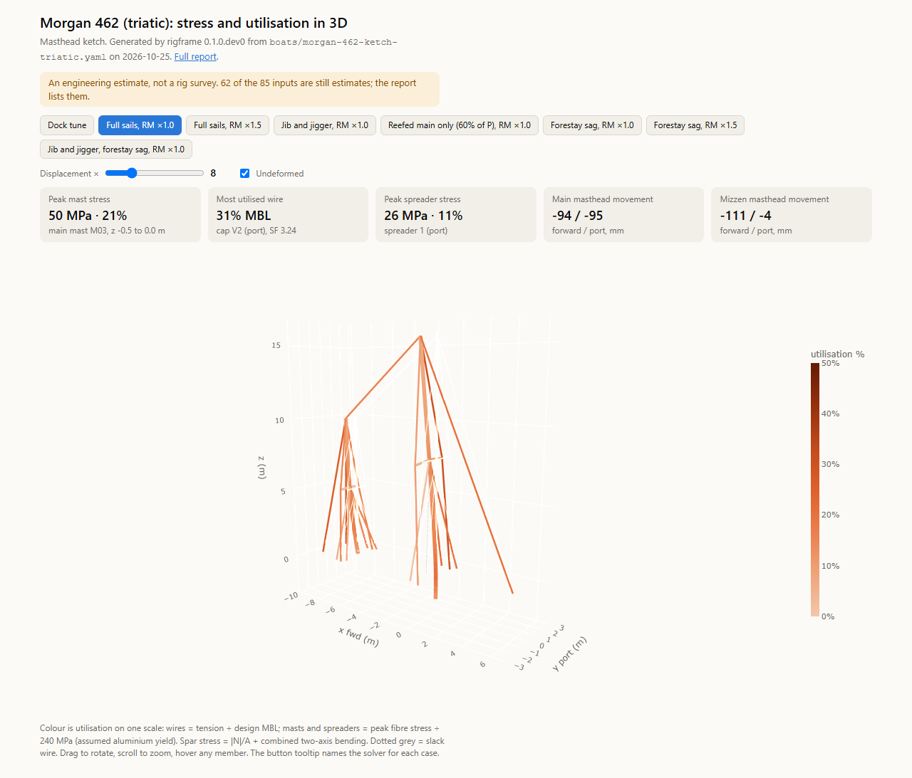

# rigframe

**A sailboat's standing rig, analysed as a 3D frame, from one YAML file.**

You describe your boat's rig in a short text file: the sail plan, the mast, the spreaders, and where each
wire goes. rigframe tunes the rig at the dock, sails it through a set of load cases, and writes a report
you can share with the owner, the rigger or the surveyor:

- a **rigging list**: every wire, its size, length, breaking load, dock tension and highest load;
- each **load case** item by item: every wire segment's tension and safety factor, the mast and spreader
  stresses, the chainplate loads, how far the mast bends;
- **buckling** of the mast;
- figures for every case;
- an **interactive 3D viewer**: pick a load case, turn the rig around, and hover over any wire or spar to
  see its load, its safety factor and how hard it's working;
- on the first page, **every input that is still an estimate**, so you know what to measure.



<sub>The 3D viewer on the Morgan 462 example (placeholder rig): full sail at RM ×1.0, every member coloured by
how close it is to its limit. Drawn with plotly.js (MIT).</sub>

You don't need to install anything or run Python. Put your file in a pull request and GitHub runs the
analysis for you.

> **Status: draft, in demo mode.** The boat-file format, its checker (`rigframe validate`), the example boats,
> the 3D viewer and the GitHub workflow are here. The analysis engine is still being moved out of the
> notebooks it was developed in. Until it lands, `rigframe run` checks your file and writes a report of its
> estimates, marked **DEMO**. For the four example boats it also replays the notebook studies' stored results
> in the viewer; those don't change if you edit the file. `pipx install rigframe` will work once it's released.

> **This is an engineering estimate, not a rig survey.** It assumes the rig is in good condition, and it
> knows nothing about corrosion, fatigue, cracked swages or worn chainplates. Have a rigger inspect the
> rig. The report says which numbers are estimates; treat them that way.

---

## Contents

- [Three ways to get a report](#three-ways-to-get-a-report)
- [Step 1: Make your boat file](#step-1-make-your-boat-file)
- [Step 2: Open a pull request with your file](#step-2-open-a-pull-request-with-your-file)
- [Step 3: Read the report](#step-3-read-the-report)
- [Keeping your boat private](#keeping-your-boat-private)
- [Running it on your own computer](#running-it-on-your-own-computer)
- [How it works](#how-it-works)
- [Adding to rigframe](#adding-to-rigframe)
- [Licences and credits](#licences-and-credits)

---

## Three ways to get a report

| | What you need | Who sees your boat |
|---|---|---|
| **A pull request to this repository** | A free GitHub account and a web browser | Everyone: this repository is public |
| **Your own private copy** | A free GitHub account | Only you, and anyone you invite |
| **Your own computer** | Python 3.12 or later | Only you |

All three start with the same boat file.

---

## Step 1: Make your boat file

The boat file says what your rig is and where each number came from. Getting the numbers together is
the hard part, so there are two ways in.

### The easy way: have an AI assistant draft it

[`prompts/make-boat-yaml.md`](prompts/make-boat-yaml.md) is a prompt you paste into an AI assistant with
web search turned on (Claude, ChatGPT, Gemini or similar). It reads this repository's rules, looks up
your boat's published data, asks you only what it can't find, and hands back:

- the file name to use;
- the finished YAML;
- the sources it used;
- a list of what to measure, most important first.

Attach photos when it asks: the rig from the side and from astern, each chainplate, the label at the mast
foot. They settle questions no website answers.

### By hand

Copy [`docs/boat-template.yaml`](docs/boat-template.yaml), or the example nearest your rig:

| Your rig | Start from |
|---|---|
| Sloop, one set of spreaders | [`docs/boat-template.yaml`](docs/boat-template.yaml) |
| Sloop, two or more sets | [`boats/beneteau-oceanis-440-1994.yaml`](boats/beneteau-oceanis-440-1994.yaml) |
| Cutter | [`boats/island-packet-40-1996.yaml`](boats/island-packet-40-1996.yaml) |
| Ketch or yawl | [`boats/morgan-462-ketch-triatic.yaml`](boats/morgan-462-ketch-triatic.yaml) or [`…-split-backstays.yaml`](boats/morgan-462-ketch-split-backstays.yaml) |

[`docs/boat-yaml.md`](docs/boat-yaml.md) explains every field, how to measure it and where to look it up.


### What a value looks like

```yaml
I: {value: 53.15 ft, basis: published, ref: gob}   # with its source
gooseneck_z: 1.75 m                                 # bare: counts as an estimate
```

Every number has a unit, and you keep the unit your source used. `basis` is `measured`, `maker`,
`published` or `estimate`. A file full of estimates still runs; the report just says so.

### Name the file

`<builder>-<model>-<year>.yaml`, lowercase, with hyphens: `catalina-36-1989.yaml`. To compare two
arrangements of the same boat, make two files and add the difference to the name:
`morgan-462-ketch-triatic.yaml` and `morgan-462-ketch-split-backstays.yaml`.

### Leave out anything personal

No owner's name, boat name, hull identification number, sail number or home port. A pull request here is
public. If you'd rather keep the boat itself private, see [Keeping your boat private](#keeping-your-boat-private).

---

## Step 2: Open a pull request with your file

A pull request is how you hand a file to a GitHub repository you don't own. You do it all in the
browser. GitHub makes your own copy of the repository (a *fork*) along the way, and you don't have to
manage it.

**Before you start:** sign in to [github.com](https://github.com). A free account is enough.

### 2.1 Add the file

1. Go to the [`boats` folder](https://github.com/rigframe/rigframe/tree/main/boats) of this repository.
2. Click **Add file** (top right, above the file list), then either:
   - **Upload files**, and drag your `.yaml` file onto the page; or
   - **Create new file**, type the file name into the box above the editor (the `boats/` part is already
     there), and paste your YAML into the editor.
3. GitHub says you need your own copy to propose a change. Click **Fork this repository**. This happens
   only the first time.

### 2.2 Propose the change

4. Click **Commit changes…** (or **Propose changes** on the upload page).
5. In the box that opens, write a title such as `Add Catalina 36 (1989)`. The description can stay empty.
6. Click **Propose changes**. GitHub shows a page titled **Comparing changes**, with your file in green.
7. Click **Create pull request**.

### 2.3 Fill in the pull request

8. The description box holds a short checklist. Tick what applies: where most of the numbers came from,
   and that the file has nothing personal in it.
9. Click **Create pull request** again. That's it: your pull request is open.

### 2.4 Watch the check

At the bottom of the pull request a check called **Boat report** appears.

- **"Waiting for approval"** or **"1 workflow awaiting approval"**: GitHub holds the first pull request
  from a new contributor until a maintainer lets it run. You don't need to do anything. It usually
  happens within a day.
- **Yellow dot**: it's running. A full run takes a few minutes.
- **Red ✗**: something in the file needs fixing. Go to [2.5](#25-if-the-check-fails).
- **Green ✓**: the report is ready. Go to [2.6](#26-open-the-3d-viewer-and-the-report).

### 2.5 If the check fails

10. Click **Details** next to the red ✗. The log opens at the step that failed.
11. Under **Check the boat files**, the checker lists each problem in plain words, usually with the line
    to fix:

    ```text
    FAIL  boats/catalina-36-1989.yaml
          - sail_plan.I (line 30): '45 feet' needs a number, a space, then one of: mm, cm, m, in, ft.
          - masts.0.shrouds.cap (line 70): Additional properties are not allowed ('pretention' was
            unexpected) Check the spelling against docs/boat-yaml.md.
    ```

12. Fix it in the browser: in your pull request click **Files changed**, then the **⋯** menu at the right
    of your file's header, then **Edit file**. Make the change, then click **Commit changes…** and
    **Commit changes**. Leave it on the same branch; GitHub offers that by default.
13. The check runs again by itself. Repeat until it's green.

If you're stuck, write a comment on the pull request and paste the error. Someone will help.

### 2.6 Open the 3D viewer and the report

There are two ways in. The first needs nothing but a click.

**Online, from the pull request.** A minute or two after the check goes green, a comment titled
**Rig report preview** appears on your pull request, posted by `github-actions`.

14. Click **Open the 3D viewer**. It opens in your browser, on a phone too.
15. Pick a load case with the buttons along the top. Drag to turn the rig, scroll or pinch to zoom, and
    hover over (or tap) any wire, mast panel or spreader to see its load. [Step 3](#the-3d-viewer) explains
    the colours.
16. **Report** and **PDF**, in the same comment, open the full report.

The links work for anyone you send them to. If one shows "404", wait a minute: GitHub Pages takes a moment
to publish. The preview follows every change you push, and it's removed when the pull request closes, so
download a copy if you want to keep it.

**As a download, to keep.**

17. Click **Details** next to the green ✓, then **Summary** at the top left of the page that opens. The
    summary shows the headline: the governing wire and its safety factor in each load case, the mast's peak
    stress, the lowest buckling factor, and how many inputs are still estimates.
18. Scroll to the bottom, to **Artifacts**, and click **rig-report-<your file name>**. You get a zip file.
    GitHub keeps it for 90 days.
19. Unzip it and double-click **`viewer.html`**. It opens in your browser and works **without internet**,
    so you can show it to someone on the dock. The zip also holds `REPORT.html`, `REPORT.pdf`, the figures,
    `viewer.json` (the results as data) and a copy of your boat file.

You can share the zip, `viewer.html` on its own, or just the PDF, with anyone.

### 2.7 What happens next

- **You only wanted the report:** close the pull request (the **Close pull request** button at the bottom).
  Your report is already downloaded.
- **You'd like the boat to stay here as an example for others:** leave it open and say so in a comment.
  The maintainer may ask a question or two, then merge it. A merged boat gets a permanent page: its 3D
  viewer at `https://rigframe.github.io/rigframe/boats/<file name>/viewer.html`, and its report beside it.
  [The front page](https://rigframe.github.io/rigframe/) lists every published boat. The pages update
  whenever rigframe improves.
- **You measured more later:** edit the file in your pull request (step 12) and the report runs again.
  If the pull request is already closed or merged, open a new one the same way.

---

## Step 3: Read the report

The report opens with the things to check first:

1. **Estimates.** Every input still marked `estimate`, most influential first. Until those are measured,
   the numbers that depend on them are estimates too.
2. **Rigging list.** Every wire with its size, length, breaking load, dock tension and highest load.
   The lengths run pin to pin on the model's geometry; they aren't cut lengths.
3. **All cases at a glance.** One row per load case: the governing wire and its safety factor, the mast's
   peak stress and utilisation, the buckling factor.

Then each load case in full, and the method: what each case means, how the sail loads are applied, the
textbook equations behind it, and the cross-check against a second solver.

### The 3D viewer

- **Colour is utilisation**, on one scale for everything: a wire's tension as a share of its breaking load,
  and a spar's peak stress as a share of the aluminium's yield. Pale is lightly loaded; dark brown is at or
  past 50%. A dotted grey wire is slack.
- **The cards** above the view give the case's peak mast stress, the most-loaded wire and its safety
  factor, the peak spreader stress, and how far each masthead moves.
- **The shape is exaggerated.** The *Displacement ×* slider sets by how much (8 times by default). Tick
  *Undeformed* to see the rig at rest behind it.
- **Hover** shows each member's numbers: tension, safety factor and wire stress for a wire; peak stress,
  axial load and bending moments for a spar. The tooltip on each case button names the solver that ran it.

### Safety factor

**Safety factor** here is the wire's minimum breaking load over its tension in that case. It has to cover
everything the model leaves out: gusts beyond the case, wave slamming, fatigue, worn fittings. Shigley's
*Mechanical Engineering Design* asks for at least 3.5 on guy wires (Table 17-25). The report explains
what each case's factor means.

---

## Keeping your boat private

If you'd rather nobody else saw your boat file or report, run rigframe in your own private copy of the
repository.

1. On this repository's page, click **Use this template** (top right), then **Create a new repository**.
2. Give it a name, choose **Private**, and click **Create repository**.
3. In your new repository, add your boat file to `boats/` exactly as in [2.1](#21-add-the-file), but
   commit it straight to `main` (there's nothing to fork).
4. Open the **Actions** tab. The **Boat report** run appears within a minute. When it's green, open it
   and download the report from **Artifacts**, as in [2.6](#26-open-the-3d-viewer-and-the-report).
   `viewer.html` in the zip is the full 3D viewer and needs no internet.

GitHub's free plan includes Actions minutes for private repositories, and one report takes a few of
them. Private repositories can't publish GitHub Pages on the free plan, so there's no online preview and
the report comes only as a download.

---

## Running it on your own computer

```bash
pipx install rigframe
```

```bash
rigframe validate boats/my-boat.yaml
```

```bash
rigframe run boats/my-boat.yaml --out reports/
```

`validate` checks the file in under a second. `run` writes the report folder, with `viewer.html` in it.
The viewer carries its own copy of plotly.js (about 5 MB), so it opens offline. To rebuild it as a 50 kB file
that fetches plotly.js from the internet instead, for a web page or an email, run
`rigframe viewer reports/my-boat/viewer.json viewer.html --cdn`. The OpenSees cross-check
needs the optional extra (`pipx install "rigframe[opensees]"`); see [Licences](#licences-and-credits).
Without it, the report says the cross-check was skipped.

In VS Code with the YAML extension, the first line of every boat file points at
[`schema/boat.schema.json`](schema/boat.schema.json), so you get completion and error marks as you type.

---

## How it works

- **The frame.** The mast and spreaders are beam elements and every wire is a tension-only bar, in
  [Pynite](https://github.com/JWock82/Pynite). Both masts of a ketch or yawl are in one model.
- **The dock tune.** Each turnbuckle's shortening is solved by Newton iteration so that every wire reaches
  its target tension at once. The forestay is reached the way a rigger reaches it, through the backstay
  (or, on a ketch with a triatic, the mizzen backstays).
- **Sailing.** One sail pressure, chosen so the heeling moment about the deck equals the righting moment at
  30° heel (times the case's factor), acts on the main's and the headsail's areas. The main's force runs
  along the mast between the boom and the head, largest at the boom. A third of the headsail's force goes to
  the masthead and the rest straight to the stem, unless the case spreads it along the stay. P-Delta
  analysis includes the mast's bow.
- **Stays that sag.** With the headsail's load spread along its stay, the stay's tension comes from its
  own stretch. That needs a large-displacement solver, so those cases run in
  [OpenSees](https://opensees.berkeley.edu/) with corotational elements and are checked against the cable
  equation.
- **Buckling** comes from the stiffness and geometric-stiffness matrices; open-section torsional-flexural
  buckling is checked by hand.
- **Cross-check.** The dock tune and the main load cases are re-run in OpenSees, and the report prints the
  differences. Pynite's linear P-Delta leaves out the shortening of a bowed mast, which puts its forestay
  1–2% above the large-displacement answer; the report flags it.
- **Checks.** Every run ends in a table of PASS/FAIL checks: equilibrium, the cross-check, the cable
  equation, Euler buckling of each panel. A failed check stops the report from calling itself finished.

The method was built and validated in three studies: a masthead sloop with discontinuous shrouds and four
lowers, a masthead cutter, and a masthead ketch with both triatic and split-backstay arrangements. Those
three are the example boats.

---

## Adding to rigframe

- **A new boat** is a pull request with a YAML file, as above.
- **A new load case** is a function registered in `rigframe/loads.py`. It takes the boat and returns
  forces on nodes; the rest of the run picks it up.
- **A new rig layout** (running backstays, a fractional rig's diamonds, a bowsprit with a bobstay) means
  teaching `rigframe/geometry.py` a new kind of wire, adding it to the schema, and adding an example boat
  that uses it. Open an issue first.
- Every change has to keep the example boats' numbers. `pytest` compares each run with stored results.

---

## Licences and credits

- **rigframe** is MIT.
- **Pynite** is MIT. **sectionproperties** is MIT. **plotly.js**, which the 3D viewer carries inside it,
  is MIT. **NumPy, SciPy, matplotlib, pandas** are BSD.
- **OpenSeesPy** is free for research, education and internal use; commercial redistribution needs a
  licence from its owners. It is not open source in the OSI sense. rigframe doesn't ship it: it's an
  optional extra you install yourself, and everything except the cross-check runs without it.
- **Wire data:** 1x19 316 minimum breaking loads from four suppliers' catalogues (Lindemann, S3i, Nance &
  Underwood, Lexco), one column each in [`data/wire_1x19_316.csv`](data/wire_1x19_316.csv). The design value
  is the lowest of them.
- **Sail-plan and hull data** for the example boats come from the sources listed in each file.
