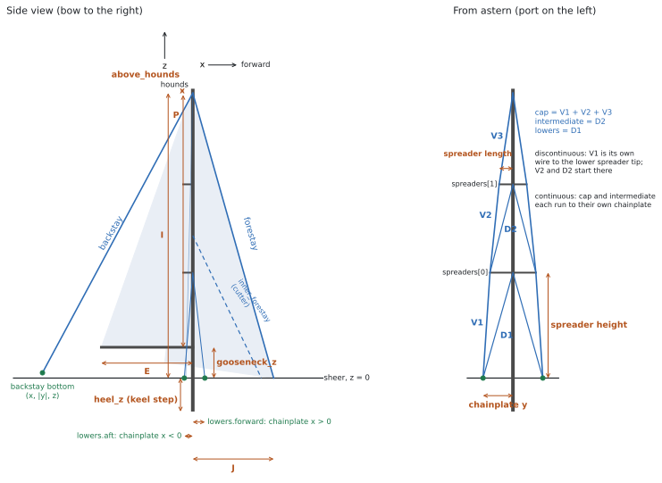

# The boat file

A boat file is one YAML file in `boats/` that describes one rig. rigframe reads it, builds the 3D frame,
tunes it at the dock, sails it through the load cases and writes the report. Nothing else about the boat
lives anywhere else.

- Start from [`boat-template.yaml`](boat-template.yaml), or from the example closest to your rig:
  [masthead sloop, two spreader sets](../boats/beneteau-oceanis-440-1994.yaml),
  [masthead cutter](../boats/island-packet-40-1996.yaml),
  [ketch with a triatic](../boats/morgan-462-ketch-triatic.yaml),
  [ketch with split backstays](../boats/morgan-462-ketch-split-backstays.yaml).
- Or have an AI assistant draft it for you with [the boat-file prompt](../prompts/make-boat-yaml.md).
- The machine-readable rules are in [`schema/boat.schema.json`](../schema/boat.schema.json). VS Code with
  the YAML extension reads the first line of every boat file and checks it as you type.



<sub>Drawn for this repository from the Oceanis 440 example. MIT.</sub>

---

## Writing a value

Every number carries its unit. Use the unit your source used; rigframe converts.

| Kind | Units | Examples |
|---|---|---|
| Length | `mm` `cm` `m` `in` `ft` | `53.15 ft`, `-19 in`, `3.7 mm` |
| Wire size | the same, with fractions | `10 mm`, `3/8 in`, `1 1/4 in` |
| Mass | `kg` `t` `lb` | `9299 kg`, `22800 lb` |
| Percentage | `%` | `20 %` (pretension), `135 %` (LP), `37 %` (a height) |
| Angle | `deg` | `15 deg` |
| Area | `mm^2` `cm^2` `m^2` `in^2` | `36.0 cm^2` |
| Second moment, torsion constant | `mm^4` `cm^4` `m^4` `in^4` | `2430 cm^4` |
| Stress, modulus | `MPa` `GPa` `ksi` `psi` | `240 MPa`, `70 GPa` |
| Moment | `N*m` `kN*m` `kgf*m` `lbf*ft` | `46.5 kN*m` |

A value can be bare, or carry where it came from:

```yaml
I: 53.15 ft                                        # bare: counts as an estimate
I: {value: 53.15 ft, basis: published, ref: gob}   # with its source
```

`basis` is one of four words. The report's first page lists every input still marked `estimate`, so the
owner knows what to measure.

| basis | Means |
|---|---|
| `measured` | Taken on this boat. |
| `maker` | The spar or rigging maker's figure for this part. |
| `published` | The builder, the designer, a class association, a review, a broker listing. |
| `estimate` | Anything else, including a value copied from an example file. |

`ref` names a key in `boat.sources`, where the full citation goes once:

```yaml
boat:
  sources:
    gob: Good Old Boat sail data, Beneteau Oceanis 440, https://goodoldboat.com/saildata/boat/beneteau-oceanis-440/
```

### Three YAML traps

1. **A comma inside `{ }` ends the value.** `{value: 650 cm^4, basis: estimate, note: traced, cell closed}`
   turns `cell closed` into a new key. Quote any note with a comma: `note: "traced, cell closed"`.
2. **No tabs.** Indent with two spaces per level.
3. **A bare number needs a unit.** `I: 53.15` fails; `I: 53.15 ft` passes. `RM_factor` is the one plain number.

---

## Axes

- `x` forward, measured from the **main mast's centreline**. Forward of the mast is positive, aft negative.
- `y` to port. Give `|y|` for anything with a port and a starboard twin; both sides are built.
- `z` up, measured from the **sheer** (the deck edge). Below deck is negative.

---

## `boat`

| Key | Required | What |
|---|---|---|
| `name` | yes | Builder and model. |
| `year` | | Model year of this boat. |
| `designer` | | |
| `rig` | yes | `masthead sloop`, `fractional sloop`, `masthead cutter`, `fractional cutter`, `masthead ketch`, `fractional ketch`, `masthead yawl`, `fractional yawl`. |
| `variant` | | What sets this file apart from another file for the same boat (`split backstays`). |
| `notes` | | Anything a reader should know: changes from factory, a replacement mast, a bowsprit, conflicting sources. |
| `sources` | | Short id → full citation. |

**Don't put the owner's name, the hull identification number, the boat's name or where it's kept in this
file.** A pull request to a public repository is public.

## `hull`

| Key | Required | What | Where to find it |
|---|---|---|---|
| `displacement` | yes | Design displacement. | Builder's brochure, sailboatdata.com, class association. When sources disagree, give the figure you used and say why in `note`. |
| `beam` | yes | Maximum beam. | Same. |
| `GZ30` | yes | Righting arm at 30° heel. $RM_{30} = \Delta \cdot g \cdot GZ_{30}$ sizes every sailing case. | A stability curve: the CE stability documents, the builder, a naval architect. Small-angle figures, such as a racing certificate's righting moment, don't give GZ at 30°. Without a curve, use `0.70 m` with `basis: estimate` and say so. |
| `RM30` | | Righting moment at 30°, if published. It wins over `GZ30`. | |

## `sail_plan`

| Key | Required | What |
|---|---|---|
| `I` | yes | Forestay hounds above the sheer. |
| `J` | yes | Front face of the main mast to the forestay tack. |
| `P`, `E` | yes | Main luff and foot. |
| `J2` | cutters | Main mast to the staysail stay's tack. |
| `PY`, `EY` | ketches, yawls | Mizzen luff and foot. |
| `headsail_LP` | | Genoa LP as a percentage of J. Default `135 %`. |
| `staysail_LP` | cutters | Staysail LP as a percentage of J2. |
| `headsail_furling` | | `true` or `false`. |
| `main_furling` | | `none`, `in-mast`, `in-boom`. An in-mast furler means the section has an open luff slot. |
| `reef_fraction` | | The deep-reefed luff as a percentage of P. Default `60 %`. |
| `main_load_shape` | | `triangular` (most load at the boom; default) or `uniform`. |

I, J, P and E are the most widely published rig figures. sailboatdata.com, Good Old Boat's sail data and
sailmakers' online sail-plan databases list them for most production boats.

## `masts`

A list of one mast (sloop, cutter) or two (ketch, yawl). One of them must have `id: main`.

| Key | Required | What | How to measure |
|---|---|---|---|
| `id` | yes | `main` or `mizzen`. | |
| `x` | | Fore-and-aft position. The main is `0 m`; a mizzen is negative. | Deck tape from the main mast to the mizzen. |
| `hounds_z` | mizzen | Hounds height above the sheer. The main's is `I`. | |
| `step` | yes | `keel` or `deck`. | Look below: does the mast pass through the deck? |
| `heel_z` | keel-stepped | The heel below the sheer, negative. | Partners to the mast step, below. |
| `gooseneck_z` | yes | Gooseneck above the sheer. | Tape from the deck. |
| `above_hounds` | yes | Masthead above the forestay tang. | From the sail plan, or from a photo with the forestay toggle for scale. |
| `section` | yes | See below. | |
| `spreaders` | yes | List, bottom to top. Can be empty. | |
| `spreader_section` | | Spreader airfoil properties. | |
| `spreader_root` | | `released` (free to rotate up and down; default) or `fixed`. | |
| `shrouds` | yes | See below. | |

### `section`

Give the maker's figures when you have them; they win over anything rigframe works out from the outline.

| Key | What |
|---|---|
| `profile` | Maker and profile name, such as `Z-Spars Z900E`. The single most useful thing to find: spar makers publish section tables with A and I for their profiles, and the profile code is often on a label at the mast foot or in the boat's papers. |
| `shape` | `oval` (default), `elliptical`, `pear`. |
| `chord`, `width`, `wall` | Fore-and-aft depth, athwart width, wall thickness. Calipers on the mast at the gooseneck. |
| `luff_slot` | Width of an open luff slot (in-mast furlers). |
| `torsion` | `closed` (default). The frame always uses a closed-section J; an open section's torsion is checked by hand in the report. |
| `A`, `mass_per_length` | Area, or mass per metre (rigframe divides by 2700 kg/m³). |
| `I_fore_aft`, `I_athwart` | Second moments: fore-and-aft bending and athwartships bending. |
| `J` | Torsion constant, if known. |
| `E`, `yield` | Default 70 GPa and 240 MPa (6061-T6 / 6082-T6). Yield is used only for the utilisation figures. |

### `spreaders`

| Key | What |
|---|---|
| `height` | Above the sheer, as a length or as a percentage of this mast's hounds height. |
| `length` | Mast centreline to the tip, along the spreader. |
| `sweep` | Sweep aft in plan view. `0 deg` is in line with the mast. |

Spreader heights are easy to get from a photo of the rig taken square-on, scaled by a known height.

### `shrouds`

| Key | What |
|---|---|
| `arrangement` | `continuous`: each shroud runs from its chainplate to its mast fitting, over the spreader tips. `discontinuous`: V1 runs from the chainplate to the lowest spreader tip, and the upper wires (V2, D2 ...) start there. |
| `cap` | The upper shroud to the hounds. |
| `intermediate` | Needed with two or more spreader sets. |
| `lowers` | `single` (one lower each side), or `forward` and/or `aft`. |

Each shroud takes:

| Key | What |
|---|---|
| `size` | 1x19 diameter: `10 mm`, `3/8 in`. Read it off the swage or the turnbuckle, or caliper the wire. |
| `segments` | Segments of a different size: `{V1: 12 mm}`. |
| `chainplate` | `{x, y}` of the chainplate pin. Not needed for an intermediate in a discontinuous rig. |
| `pretension` | Dock tune target, as a percentage of the wire's breaking load, on the gauged segment. Typical: caps 15–20 %, lowers 10–15 %. |
| `gauge_on` | The segment the tune is measured on (`V2`). Default: the bottom one. |

Segment names: V1, V2, V3 run up the cap from the bottom; D1 is a lower, D2 an intermediate. The figure
at the top shows them.

**Chainplate positions are the measurement that matters most.** In the cutter example, how far aft the aft
lowers land decides whether they can hold the staysail stay.

## `stays`

| Key | Required | What |
|---|---|---|
| `id` | yes | Your name for it. Other stays refer to it by this. |
| `kind` | yes | `forestay`, `inner_forestay`, `backstay`, `triatic`, `mizzen_forestay`, `mizzen_backstay`. |
| `top` | yes | `{mast: main, at: hounds}`, `{mast: main, at: masthead}`, or `{mast: main, at: 50 %}`. |
| `bottom` | yes | A deck point `{x, y, z}`, or a mast fitting (a triatic's bottom is `{mast: mizzen, at: hounds}`). |
| `legs` | | `single` (default) or `split`: one leg each side, and `bottom.y` is half the spread. |
| `size` | yes | 1x19 diameter. |
| `pretension` | | Dock tune target, % of breaking load. |
| `adjusts` | | The stay whose tension this stay's adjuster sets. A backstay usually `adjusts: forestay`, because the forestay sits inside the furler. |
| `carries` | | `headsail`, `staysail`. |

### What each rig type needs

| Rig | Masts | Stays |
|---|---|---|
| Sloop | `main` | `forestay`, and a `backstay` (single or split) |
| Cutter | `main` | `forestay`, `inner_forestay`, `backstay`. Without running backstays, the aft lowers or the backstay hold the inner forestay. |
| Ketch or yawl, triatic | `main`, `mizzen` | `forestay`, `triatic`, `mizzen_backstay` that `adjusts: forestay` |
| Ketch or yawl, split backstays | `main`, `mizzen` | `forestay`, `backstay` (split, round the mizzen), `mizzen_forestay`, `mizzen_backstay` |

A two-masted rig with no triatic needs a `mizzen_forestay`, or nothing holds the mizzen head forward and
the dock tune has no solution. The checker says so.

To compare two arrangements of the same boat, write two files and set `boat.variant` in each.

## `load_cases`

Leave it out and rigframe runs a default set for the rig type: full sail at RM ×1.0 and ×1.5, headsail
only, deeply reefed main only, and the forestay-sag case. To choose your own:

```yaml
load_cases:
  - {name: "Full sails, RM ×1.0", sails: full, RM_factor: 1.0}
  - {name: "Forestay sag, RM ×1.5", sails: full, RM_factor: 1.5, headsail_load: along_stay}
```

| `sails` | Meaning |
|---|---|
| `full` | Full main and headsail. |
| `headsail_only` | Headsail alone. |
| `main_only` | Full main alone. |
| `reefed_main_only` | Main reefed to `reef_fraction`, nothing else. |
| `staysail_reefed_main` | Cutter heavy-weather rig. |
| `jib_and_jigger` | Ketch or yawl: headsail and mizzen, no main. |

`RM_factor` scales $RM_{30}$ (gusts, heel past 30°). `headsail_load: along_stay` spreads the sail's pull
along its stay so the stay sags, and runs the large-displacement (corotational) solver, which is the only
way to get the stay's real tension in that case.

## `analysis`

All optional.

| Key | Default | What |
|---|---|---|
| `wire.construction` | `1x19` | |
| `wire.material` | `316` | |
| `wire.E` | `107.5 GPa` | Effective modulus on the gross area. |
| `max_element` | `0.5 m` | Longest mast element. |
| `stay_segments` | `12` | Segments per stay in the sag cases. |
| `crosscheck` | `opensees` | `none` skips the OpenSees cross-check. |

---

## What the checker checks

`rigframe validate boats/my-boat.yaml` runs first, on your machine or in the pull request. It checks:

- the YAML itself (indentation, tabs, the comma trap);
- every key name and every unit, against the schema;
- that the masts and stays match the rig type (a cutter has an inner forestay, a ketch has two masts);
- that every `mast:` and `adjusts:` names something that exists;
- that the main's head fits below the masthead, spreaders run bottom to top below the hounds, and a
  keel-stepped mast has its heel below deck;
- that something holds each masthead aft and forward.

It then prints how many inputs are still estimates. A file can pass with every value an estimate; the
report will say so on its first page.
