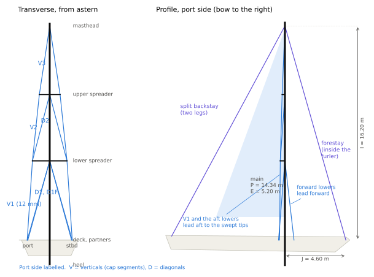
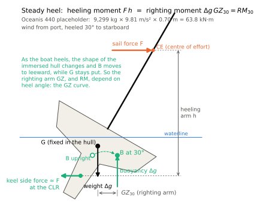
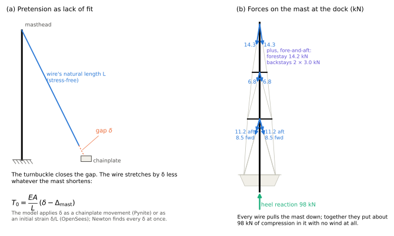
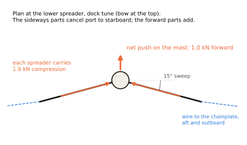
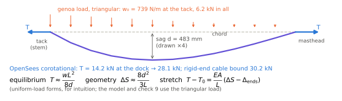
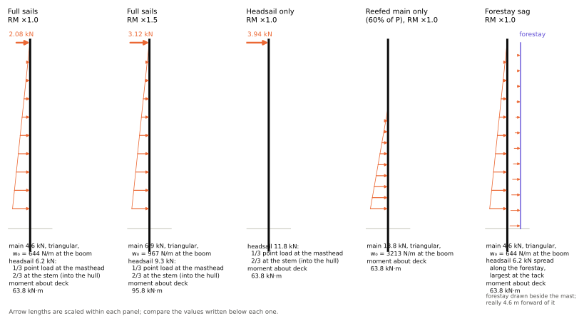
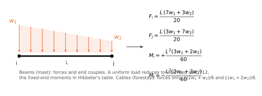
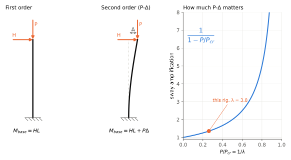

# Sailboat rig 3D analysis: companion notes

This note explains what the notebook
[notebooks/beneteau-oceanis-440-1994.ipynb](https://github.com/rigframe/rigframe/blob/main/notebooks/beneteau-oceanis-440-1994.ipynb)
computes and why. It covers:

- **The load scenarios** and exactly how each one loads the rig, as point loads, distributed loads or
  enforced displacements, with free-body diagrams.
- **Definitions** of the terms the notebook uses, from *righting moment* to *P-Delta* and *torsional-flexural
  buckling*.
- **The equations behind the model,** traced to the textbooks by equation number and printed
  page.
- **Standards and design references** for rigs, with what each one covers and what was checked here.

The notebook stays the place for code and results; this note holds the explanation. Every number below
comes from the notebook's **default inputs**. The mast section is real: a Z-Spars Z900E, from the
owner's figures and profile drawing. The owner has also measured the lowers (their wire sizes and how far
their chainplates sit fore and aft of the mast), the 12 mm V1 of the discontinuous shrouds, and the backstay
spread. The rest of the rig geometry, the
other wire sizes and $GZ_{30}$ are still placeholders until the boat is measured (the notebook's closing
list says which). Treat the numbers as an illustration of the method, not as a
verdict on the rig. The figures are drawn from the model's own geometry and loads.

**The full numbers** live in [Sailboat_rig_3D_Oceanis440_REPORT.md](Sailboat_rig_3D_Oceanis440_REPORT.md), which
the notebook writes on every run (its §13). It breaks down each load case item by item: every wire segment,
every mast panel, each spreader, the load on each hull fitting, and the key displacements. Each case also
gets a four-panel figure: the deflected rig from astern and in profile, coloured by utilisation, with the
sail loads drawn on; mast stress against height; and every wire's % of MBL. This note keeps only the
headline values.

**Contents**

1. [The rig and its parts](#1-the-rig-and-its-parts)
2. [Where the load comes from: the righting moment](#2-where-the-load-comes-from-the-righting-moment)
3. [The load scenarios](#3-the-load-scenarios)
4. [How the loads are applied in the model](#4-how-the-loads-are-applied-in-the-model)
5. [Analysis concepts and definitions](#5-analysis-concepts-and-definitions)
6. [Equations from the textbooks](#6-equations-from-the-textbooks)
7. [Standards, specifications and design references](#7-standards-specifications-and-design-references)
8. [Where each topic lives in the notebook](#8-where-each-topic-lives-in-the-notebook)

---

## 1. The rig and its parts

*Figure 1. The model's geometry. Left: looking forward from astern. Right: the port side. The lower
chainplates' fore-and-aft positions and the backstay spread are measured; the spreaders, the other
chainplate coordinates and the backstay feet's fore-and-aft position are placeholders.*

| Term                     | Meaning                                                                                                                  | In the model                        |
| ------------------------ | ------------------------------------------------------------------------------------------------------------------------ | ----------------------------------- |
| **I**                    | Height of the forestay attachment above the sheer (deck edge)                                                            | 16.20 m (published)                 |
| **J**                    | Mast to forestay tack, along the deck                                                                                    | 4.60 m (published)                  |
| **P, E**                 | Mainsail luff and foot lengths                                                                                           | 14.34 m, 5.20 m (published)         |
| **Masthead rig**         | The forestay goes to the top of the mast, so caps, forestay and backstay all meet there                                  | yes (Farr design #202)              |
| **Discontinuous shrouds** | Each side has one V1, from the chainplate to the lower spreader tip; the cap and the intermediate both start there, joined at the tip, so V1 carries both | yes (owner)                         |
| **Caps** (V1, V2, V3)    | V1 to the lower spreader tip, then V2 over the upper spreader tip and V3 to the masthead                                | V1 12 mm (measured); V2, V3 10 mm   |
| **Intermediates** (D2)   | From the lower spreader tip to the upper spreader root                                                                   | 8 mm, made to length                |
| **Lowers** (D1, D1F)     | From the chainplate straight to the lower spreader root. The boat has four: a forward and an aft lower each side (below) | aft 12 mm, forward 10 mm (measured) |
| **Swept spreaders**      | Spreaders angled aft (15° here), so the shrouds lead aft of the mast and can hold it fore-and-aft as well as sideways    | placeholder                         |
| **Spreader root, tip**   | The end at the mast, the end at the wire. The tip clamps the wire; the root bracket lets the spreader rotate up and down | root released in the vertical plane |
| **Chainplate**           | The hull fitting a shroud's turnbuckle pins to                                                                           | each wire has its own, fully fixed  |
| **Partners**             | Where a keel-stepped mast passes through the deck. They hold the mast sideways but not up and down                       | fixed in x and y                    |
| **Heel, step**           | The mast's foot on the keel                                                                                              | pinned, twist held                  |
| **Split backstay**       | Two backstay legs from the masthead to the transom quarters                                                              | 8 mm each; feet 6 ft apart (measured) |
| **Furler, furling mast** | The mainsail rolls into a slot inside the mast; the genoa rolls around a foil over the forestay                          | Z-Spars Z900E, §5                   |

### The four lowers (forward and aft)

The Oceanis 440 carries **four lower shrouds**, two each side: a **forward lower** whose chainplate is
forward of the mast and an **aft lower** whose chainplate is aft of it. Both run straight from the deck to
the mast just below the lower spreader root, so together they're the D1 diagonals, D1F and D1A. Two
broker listings describe the rig this way: a 1998 boat's "4 bas-haubans" (four lowers) with intermediates,
uppers and a double backstay, and a mid-1990s boat's "fore and aft lowers". The owner confirms it on this boat.

**They aren't checkstays, but they do part of a checkstay's job.**

- **A checkstay** is an *adjustable* stay from the middle of the mast (around the lower spreader or the
  inner-forestay height) back to the quarter. It's a light running backstay: the windward one is set up,
  the leeward one cast off so the boom can swing, and it's re-set at every tack. Checkstays turn up on
  fractional rigs, and on masthead rigs with an inner forestay, whose pull forward at mid-mast they balance.
  The model has none, and none is listed for the boat.
- **Fore and aft lowers** are *fixed* standing rigging, set at the dock and left alone. Like checkstays,
  they hold the middle of the mast fore-and-aft and damp pumping. Unlike checkstays, they also hold it
  sideways, and they work on both tacks at once.

**What each pair does.** A wire can only pull, and it pulls the mast toward its own chainplate.

- **The aft lowers** pull the lower spreader root **aft**, so they stop the mid-mast moving forward. That
  matters here because swept spreaders push the mast forward at the same point (about 1.0 kN at the dock
  tune, Figure 4), and the main's luff tension and the vang bend it forward too.
- **The forward lowers** pull it **forward**, so they stop the mid-mast moving aft. A mast whose middle
  goes aft of the line from partners to masthead is **inverted**; once that starts, backstay tension drives
  it further, and an inverted keel-stepped mast is one way rigs fail. The forward lowers are the guard
  against it, which is why riggers usually set them a little tighter than the aft lowers.
- **Sideways,** all four hold the lower spreader root to windward, just as two lowers would. The leeward
  pair goes soft as the boat heels.

The fore-and-aft pull is a small part of each wire's tension. The owner measured the chainplates: the
aft lowers' are 19 in (0.48 m) aft of the mast centreline and the forward lowers' 27 in (0.69 m) forward.
Both lowers reach the mast 6.0 m up, so about 8% of an aft lower's tension acts fore-and-aft and about 11%
of a forward lower's, against about 27% athwartships. At the dock tune (11.2 kN in each 12 mm aft lower,
8.5 kN in each 10 mm forward lower) the aft pair pulls the spreader root back by 1.7 kN and the forward
pair pulls it forward by 1.9 kN. The two pairs nearly cancel, so nothing at that point offsets the swept
spreaders' 1.0 kN forward push (Figure 4). The mast bows 45 mm forward of its partners-to-masthead line at
the lower spreader, and the peak stress sits there (§3.6). Take the forward lowers away and the aft pair's
1.7 kN nearly cancels the push instead: the bow there is only 2 mm. What the pairs add is stiffness,
because whichever way the spreader root moves, one pair tightens.

**Pumping** is the mast's middle panel flexing fore-and-aft, in rhythm, in a seaway. The forestay and
backstay hold the masthead, and the partners and heel hold the foot. Between them the mast is a long
column, and as the boat pitches, the changing forestay load and the rig's own inertia set its first
fore-and-aft mode going. With only aft lowers, the spreader root is held one way: as it moves aft the aft
lowers go slack, and only the mast's own bending stiffness resists. With a pair on each side, the spreader
root is held both ways. That's why fore and aft lowers cure pumping, and why a pumping mast is usually a
sign of slack lowers.

**How much they stiffen this mast.** A wire resists sideways motion of its top through the part of its
stretch that the motion causes, so its fore-and-aft stiffness goes as
$\tfrac{EA}{L}\left(\tfrac{x_{cp}}{L}\right)^2$ plus the string term $T/L$. The lowers are steep, but the
measured chainplates sit well fore and aft: each 12 mm aft lower adds about 13 kN/m and each 10 mm forward
lower about 18 kN/m. The notebook's §10 stiffness probe (a 1 kN push at each spreader root, both ways; the
report prints the full table) gives:

| Fore-and-aft stiffness at the lower spreader root | Two lowers | Four lowers |
|---|---|---|
| Dock | 67 kN/m | 101 kN/m (+50%) |
| Full sails, RM ×1.0 | 67 kN/m | 100 kN/m (+51%) |
| Reefed main only, pushed forward / aft | 47 / 48 kN/m | 101 / 92 kN/m (+94–114%) |

The forward pair adds about 34 kN/m, which matches the hand estimate of two wires at 18 kN/m. It matters
most in the deeply reefed case. There, the leeward aft lower is nearly slack, so with two lowers the spreader
root is held by the windward one alone, and it is about 30% softer than at the dock. With four it isn't.
The upper spreader root gains 26–58%. Pumping itself is a dynamic, pitching-driven motion, and none of the
cases model it; the stiffness above is the static measure of resistance to it. Because the stiffness goes as
$x_{cp}^2$, the chainplates' fore-and-aft positions matter more here than anything else in the model, and
at 27 in the forward lowers do far more than the 0.35 m placeholder suggested (+16%).

**Tuning them** (general practice, not an Oceanis 440 figure):

- Set the lowers last, after the caps and intermediates, at about 10–12% of MBL (§7, Brion Toss as
  quoted). Sight up the mainsail track: the mast should be straight athwartships, with the pre-bend the
  swept spreaders put in fore-and-aft.
- Keep the **aft lowers a little looser than the forward lowers,** so the mast can't invert when the
  backstay comes on. Too tight aft lowers also take out the pre-bend. On this boat the aft lowers are the
  bigger wire, so the same gauge percentage is more tension: 11% of a 12 mm wire is 11.2 kN, against
  8.5 kN for 12% of a 10 mm one.
- **But this is an in-mast furling mast.** Riggers generally keep a furling mast close to straight, so the
  furler turns freely inside it. In the model the 12% / 11% split leaves 45 mm of pre-bend at the lower
  spreader, and setting the aft lowers up more would reduce it. Check the Z-Spars tuning guide for the
  Z900E before taking the general advice above; the model's split is a placeholder.
- Finish under sail. If the mast bends to leeward at the lower spreader, take up the *windward aft* lower;
  if it bows aft, take up the forward lowers.

**In the model.** All four lowers are in the default run (`forward_lowers = True`), each pair with its own
turnbuckle in the tune: the 12 mm aft lowers (`lower_D1`) at 11% of MBL, from 0.483 m aft of the mast, and
the 10 mm forward lowers (`lowerF_D1F`) at 12%, from 0.686 m forward. All four end at the lower spreader
root. The fore-and-aft positions and sizes are the owner's measurements; the chainplates' athwartships
positions ($\lvert y\rvert$ = 1.70 and 1.65 m) are still placeholders. `forward_lowers = False` gives the
same rig with the forward pair removed.

**What the forward pair changes** (same measured inputs, two lowers against four):

| Result | Two lowers | Four lowers | Why |
|---|---|---|---|
| Mast compression at the dock | 81 kN | 98 kN | two more wires pulling the mast down |
| Deeply reefed main: windward lower load | 32.8 kN aft, SF 3.1 (the governing wire) | 21.7 kN aft + 15.6 kN forward, SF 4.7 and 4.6 | the load is shared by two wires |
| Deeply reefed main: mast peak stress | 103 MPa, 43% | 86 MPa, 36% | the spreader root holds better, so less bending at the partners |
| Dock pre-bend at the lower spreader | 2 mm forward | 45 mm forward | without the forward pair, the aft pair's pull nearly cancels the spreaders' push |
| Where the mast's peak stress sits (most cases) | at the partners | just below the lower spreader root | the pre-bend peaks there (§3.6) |
| Dock-tune mast peak stress | 45 MPa, 19% | 48 MPa, 20% | more compression, and the larger pre-bend |
| Fore-and-aft stiffness at the lower spreader root | 47–67 kN/m | 92–101 kN/m | the forward pair, about 18 kN/m per wire |
| First buckling factor λ | 4.4 | 3.8 | more compression |
| Lowest wire SF, any sailing case | 2.05 (forestay, sag ×1.5) | 2.05 (forestay, sag ×1.5) | the forestay case doesn't involve the lowers |

With two lowers the deeply reefed main makes the windward aft lower the governing wire. With four it
isn't: the windward forward lower, at SF 4.6, is the most loaded wire in that case. Across the lumped-load
cases the caps now govern instead (§3).

**Maintenance and replacement.** These points came from a summary the owner collected; they're general
rigging practice and weren't checked against Beneteau documentation.

- **Wire and terminals.** 1x19 316 stainless, with swaged or mechanical (Sta-Lok, Hi-MOD) terminals and
  stainless or chrome-bronze turnbuckles at the deck.
- **Inspect the bottom terminals.** The lower swage, just above the turnbuckle, is where water sits.
  Look there for rust weeping, crevice corrosion and hairline cracks, with a lens or dye penetrant. The
  summary's claim that this is a known weakness of Beneteaus of this era wasn't confirmed.
- **One wire at a time.** With the boat tied up in calm weather, a lower can be replaced with the mast
  stepped, as long as only one wire is off and the rest of the rig stays tensioned. With four lowers, the
  other lower on that side keeps holding the spreader root sideways while one is off.
- **Measure, don't order off a sheet.** See *Before ordering* under the rigging list. Rigs stretch, and an
  earlier owner may have changed the rake, so the old wire's pin-to-pin length is the reference.
- **Parts.** Beneteau's
  [help desk](https://help.beneteau.com/hc/en-us/categories/360003496138-Look-for-spare-parts) is the place
  to ask for spare parts and rig drawings (not opened here).
- **Spreader sweep.** The summary also says the spreaders are "inline or slightly swept". Wikipedia gives
  two sets of 18° swept spreaders for the Beneteau 44 CC, the centre-cockpit boat on the same Farr design;
  the model's 15° is a placeholder until it's measured.

### Rigging list

Every piece of standing rigging in the model, laid out the way a rigging order is: what it is, how many, the wire, and its length, with the breaking load and the highest load this study puts on it. The
discontinuous caps are listed as two pieces each side: the 12 mm V1, which also carries the intermediate's
load, and the 10 mm V2 + V3 above it. The mast section is the real Z-Spars Z900E, and the lowers' sizes and chainplate fore-and-aft positions, V1's size and the backstay spread are the owner's measurements. The spreader heights and lengths, the other chainplate coordinates and the other wire sizes are placeholders, so those lengths and sizes are estimates.

| Item and where it runs | Qty | Wire, 1x19 316 | Length, centre to centre (each) | Design MBL | Dock tune | Highest load in any case | Size |
| --- | ---: | --- | --- | --- | --- | --- | --- |
| **Forestay (inside the genoa furler)**: stem to masthead | 1 | 10 mm (10.0 mm) | 16.84 m (55 ft 3 in) | 71.1 kN (15,987 lbf) | 14.2 kN (20%) | 34.8 kN, SF 2.0 (Forestay sag, RM ×1.5) | placeholder |
| **Backstay legs (split backstay)**: transom quarter to the masthead | 2 | 8 mm (8.0 mm) | 18.08 m (59 ft 4 in) | 45.5 kN (10,232 lbf) | 3.0 kN (7%) | 11.0 kN, SF 4.1 (Forestay sag, RM ×1.5) | placeholder |
| **Caps (uppers), V1**: chainplate to the lower spreader tip; carries the cap and the intermediate | 2 | 12 mm (12.0 mm) | 6.01 m (19 ft 9 in) | 102.0 kN (22,933 lbf) | 20.8 kN (20%) | 35.8 kN, SF 2.8 (Forestay sag, RM ×1.5) | measured |
| **Caps (uppers), V2 + V3**: lower spreader tip, over the upper spreader tip, to the masthead (one wire) | 2 | 10 mm (10.0 mm) | 10.30 m (33 ft 9 in) | 71.1 kN (15,987 lbf) | 14.3 kN (20%) | 26.0 kN, SF 2.7 (Headsail only, RM ×1.0) | placeholder |
| **Intermediates**: lower spreader tip to the upper spreader root (D2) | 2 | 8 mm (8.0 mm) | 5.20 m (17 ft 1 in) | 45.5 kN (10,232 lbf) | 6.8 kN (15%) | 11.9 kN, SF 3.8 (Full sails, RM ×1.5) | placeholder |
| **Forward lowers**: forward chainplate (27 in forward of the mast) to the lower spreader root | 2 | 10 mm (10.0 mm) | 6.25 m (20 ft 6 in) | 71.1 kN (15,987 lbf) | 8.5 kN (12%) | 15.6 kN, SF 4.6 (Reefed main only, RM ×1.0) | measured |
| **Aft lowers**: aft chainplate (19 in aft of the mast) to the lower spreader root | 2 | 12 mm (12.0 mm) | 6.25 m (20 ft 6 in) | 102.0 kN (22,933 lbf) | 11.2 kN (11%) | 21.7 kN, SF 4.7 (Reefed main only, RM ×1.0) | measured |

**Wire totals by size** (the pieces above, centre-to-centre lengths, before any allowance for terminals):

| Wire | Pieces | Total length | MBL sources in the wire table |
| --- | ---: | --- | ---: |
| 12 mm (12.0 mm) 1x19 316 | 4 | 24.5 m (80 ft) | 3 |
| 10 mm (10.0 mm) 1x19 316 | 5 | 49.9 m (164 ft) | 3 |
| 8 mm (8.0 mm) 1x19 316 | 4 | 46.6 m (153 ft) | 3 |

**Before ordering from this list:**

- **The lengths are not cut lengths.** Each is measured in the model from the mast's centreline at the attachment height to the chainplate pin at deck level, along the wire. A real wire is made to its pin-to-pin length: tang to chainplate, with the turnbuckle and toggles at their working setting. The tangs sit off the centreline and the chainplate pins sit above the deck, so the real length differs by several centimetres even where the geometry is right, and here most of the geometry is a placeholder.
- **Measure the old wire,** pin to pin with its turnbuckle at the tuned setting, and note how much thread shows, so the new wire is made to leave the turnbuckle near mid-travel with room to tune both ways. Or have a rigger measure the spar and chainplates. Use this list for what's needed, the sizes and quantities, and the loads to compare fittings against.
- **Terminals, toggles and turnbuckles aren't in the model.** Size them to match the wire, and check that each fitting's rated load is at least the wire's MBL.
- **MBL is the lowest of the catalogs in the wire table;** where it rests on a single catalog the totals table says so. Use the figure on the new wire's certificate.
- **The highest load** is the largest tension any of this study's cases puts on that wire, on either side, at the placeholder $GZ_{30}$. Port and starboard wires are the same length and see the same loads on opposite tacks.

---

## 2. Where the load comes from: the righting moment

*Figure 2. In a steady heel, the sail's heeling moment equals the hull's righting moment.*

A sailing rig is unusual among structures: **its design load is capped by the hull, not by the wind.**
The wind can only push on the sails as hard as the boat resists heeling. Push harder and the boat
simply heels further, spilling wind. So the load to design for is the hull's righting moment.

- **Righting moment, $RM$.** At a heel angle $\phi$, weight acts down through the centre of gravity
  $G$ and buoyancy acts up through the centre of buoyancy $B$, which has moved to leeward. The two form
  a couple:
  $$RM(\phi) = \Delta\, g\, GZ(\phi)$$
  where $\Delta$ is the displacement (mass) and $GZ$ the righting arm, the horizontal distance between
  the two lines of action.
- **G is fixed; B moves.** $G$ is fixed in the hull, as long as nothing aboard shifts (crew on the rail
  and water in the bilge do move it). $B$ is the centroid of the immersed volume. As the boat heels, the
  immersed shape changes and $B$ slides to leeward. So $GZ$, and with it $RM$, is a function of heel
  angle: the **GZ curve** (stability curve). For small angles $GZ \approx GM\sin\phi$, where the
  metacentric height $GM$ is the distance from $G$ up to the metacentre $M$, the point the buoyancy line
  pivots about for small heels. At larger angles the curve departs from that: it peaks, then falls to
  zero at the angle of vanishing stability. $RM_{30}$ is a single point on that curve, which is why the
  boat's own curve is needed to replace the placeholder.
- **$RM_{30}$** is the righting moment at 30° heel, the traditional reference point for rig sizing: a
  cruising boat is near its practical driving limit there. For the Oceanis 440 the notebook assumes
  $GZ_{30} = 0.70$ m, giving $RM_{30} = 9{,}299 \times 9.81 \times 0.70 = 63.8$ kN·m. **That $GZ$ is a
  placeholder**; the boat's stability curve (CE documentation, ISO 12217-2) would replace it.
- **Heeling moment.** The sail force $F$ acts at the centre of effort (CE); the keel's side force acts
  at the centre of lateral resistance. They form a couple $F\,h$ with arm $h$. In a steady heel
  $F\,h = RM$.
- **Why $h$ is vertical, and why no pivot point appears.** A couple is two equal and opposite forces,
  and its moment is the force times the perpendicular distance between their lines of action. That
  moment is the same about every point. The sail and keel forces are horizontal, so $h$ is the vertical
  distance between them. Weight and buoyancy are vertical, so $GZ$ is horizontal. The boat does roll
  about an axis near the waterline and $G$, but that only matters for its motion, not for the steady
  balance $F\,h = \Delta g\,GZ$.
- **What the rig has to carry.** The shrouds deliver the sail force into the hull at the chainplates.
  The notebook uses the conservative rule that **the moment of the sail force about the deck equals
  $k\,RM_{30}$**. Measuring the arm from the deck instead of from the centre of lateral resistance
  makes the arm shorter and the force larger. $k$ is `RM_factor`: 1.0 for the steady case, 1.5 for gusts
  and heel past 30°.

---

## 3. The load scenarios

Every case starts from the same **dock tune**, and the sailing loads are added on top in one
nonlinear solve. Tension-only wires and P-Delta are not linear, so the cases can't be added up
afterwards. Heel is always to starboard: wind from port, so the **port** (windward) shrouds load up
and the **starboard** (leeward) ones unload.

| Case | What it represents | Sail load on the rig | Notebook |
|---|---|---|---|
| **Dock tune** | Tied up, no wind; every wire carries only its turnbuckle pretension | none; enforced turnbuckle shortenings only | §5 |
| **Full sails, RM ×1.0** | Steady beat at 30° heel, full main and furling genoa | main: triangular distributed load on the mast; genoa: 1/3 as a point load at the masthead | §4, §6 |
| **Full sails, RM ×1.5** | The same with a gust or heel-beyond-30° factor | as above, ×1.5 | §10 |
| **Headsail only** | Main furled; the whole heeling moment through the genoa | point load at the masthead only | §10 |
| **Reefed main only** | Genoa furled, main deeply reefed (60% of P); the load sits low on the mast | triangular load over the lower 60% of P | §10 |
| **Forestay sag** | Full sails, with the genoa's load acting along the forestay, which bows to leeward | main as above; genoa as a triangular load along a 12-segment forestay | §10 |

The headline results with the defaults (OpenSees corotational for the sag case; the notebook's §10
table has every column, and the report has every item):

| Case              | Windward V1 (12 mm) | Inter D2 | Aft lower D1 | Fwd lower D1F | Forestay | Mast compression | Min SF (wire)   | Mast peak stress | Mast util. |
| ----------------- | ------------------- | -------- | ------------ | ------------- | -------- | ---------------- | --------------- | ---------------- | ---------- |
| Dock tune         | 20.8 kN             | 6.8      | 11.2         | 8.5           | 14.2     | 98 kN            | 4.9 (V1)        | 48 MPa           | 20%        |
| Full sails ×1.0   | 30.6                | 10.2     | 16.1         | 11.8          | 14.2     | 98               | 3.3 (V1)        | 53               | 22%        |
| Full sails ×1.5   | 35.4                | 11.9     | 18.6         | 13.3          | 14.2     | 98               | 2.9 (V1)        | 57               | 24%        |
| Headsail only     | 35.2                | 9.9      | 13.2         | 9.7           | 14.2     | 98               | 2.7 (V3)        | 49               | 20%        |
| Reefed main only  | 20.8                | 6.9      | 21.7         | 15.6          | 14.2     | 98               | 4.6 (fwd lower) | **86**           | **36%**    |
| Forestay sag ×1.0 | 30.7                | 10.2     | 15.7         | 10.3          | 28.1     | 114              | 2.5 (forestay)  | 56               | 23%        |
| Forestay sag ×1.5 | 35.8                | 11.8     | 17.8         | 11.1          | 34.8     | 122              | 2.05 (forestay) | 62               | 26%        |

Mast utilisation is peak stress ÷ an assumed 240 MPa yield (§3.6).

### 3.1 Dock tune

*Figure 3. (a) Pretension as lack of fit. (b) The forces the wires put on the mast at the dock.*

**What it is.** The rig with no wind. Each wire has been tightened with its turnbuckle to a target
tension, measured with a gauge on its bottom segment, as a percentage of its breaking load:

| Wire | Target | Set by |
|---|---|---|
| Caps | 20% MBL (14.2 kN), gauged on the 10 mm V2 | V1 deck turnbuckles |
| Intermediates | 15% (6.8 kN) on D2 | D2 made to length |
| Aft lowers (12 mm) | 11% (11.2 kN) | aft lower turnbuckles |
| Forward lowers (10 mm) | 12% (8.5 kN) | forward lower turnbuckles |
| Forestay | 20% (14.2 kN) | the backstay adjuster, as a rigger would set it |

These are typical cruising values. Loos's gauge instructions cap tension at 25% of breaking strength,
and the percentages quoted from Brion Toss are 15–20% uppers, 12–15% intermediates, 10–12% lowers
(§7). The forward lowers are set a point tighter than the aft ones, so the mast can't invert (§1).
V1 then carries the cap and the intermediate together: 20.8 kN, 20% of its own 12 mm MBL. Every wire pulls
the mast down, so the dock tune alone puts **about 98 kN** of compression in the mast. The steady sailing cases barely add to it; they move tension from the leeward wires to the
windward ones.

**How it is modelled.** Pretension is a **lack of fit**: closing a turnbuckle by $\delta$ is the same as
fitting a wire $\delta$ too short. In the frame model each wire has its own chainplate node, moved by $\delta$
along the wire (Pynite, enforced displacement); in OpenSees the same $\delta$ is an initial strain
$\delta/L$. A Newton iteration finds all five settings at once (the V1 turnbuckles, the length D2 is made to,
the aft and forward lower turnbuckles, and the backstay), because tightening any one wire changes the others.
D2 runs between two free nodes, so Pynite can't move a support to shorten it; its lack of fit goes in as end
forces $F = EA\delta/L$ instead, with $F$ added back to its tension. Linear runs of both solvers agree exactly
on that.

**Swept spreaders push the mast forward.** A spreader carries compression along its own axis. When
it's swept, its root is forward of its tip, so it pushes the mast forward as well as sideways. Port and
starboard sideways pushes cancel; the forward parts add. That's the source of the **pre-bend** a rigger
tunes into a swept-spreader mast. The forward and aft lowers' pulls nearly cancel each other, so the push
goes unanswered and the mast bows 45 mm forward at the lower spreader (§1, §3.6).

*Figure 4. Plan view at the lower spreader, dock tune. Each spreader carries about 1.9 kN, and the
two together push the mast forward by about 1.0 kN.*

### 3.2 Full sails, RM ×1.0 and ×1.5

The sail force is split between the main and the genoa **by area**, at a common pressure $p$:

$$A_m = \tfrac12 P E, \qquad A_h = \tfrac12 I J \cdot \frac{LP}{J}, \qquad
p = \frac{k\,RM_{30}}{A_m\,\bar z_m + A_h\,I/3}$$

with $\bar z_m = z_{boom} + P/3$ the height of the main's load centroid and $LP/J = 1.35$ for a
135% furling genoa (a placeholder). With the defaults, $p = 124$ Pa, the main carries 4.6 kN and the genoa
6.2 kN.

- **Main:** a **triangular distributed load on the mast** from the boom to the head of P, largest at the
  boom ($w_0 = 2F_m/P = 644$ N/m), because the sail's chord shrinks toward the head.
- **Genoa:** the genoa is a triangle hung on the forestay with its centroid at $I/3$. ==Statics splits its==
  ==force **1/3 at the masthead and 2/3 at the stem**. The masthead third (2.08 kN) is a **point load** on==
  ==the rig; the stem two-thirds go straight into the hull and never load the rig.== That split keeps the
  moment about the deck exactly $k\,RM_{30}$ (notebook check 6).
- **×1.5** scales every sail load by 1.5. Tensions rise by much less, because only the sailing increment
  scales; the preload is already there.

### 3.3 Headsail only

All the heeling moment goes through the genoa, so the masthead point load triples to 3.94 kN and there's
no load on the mast below. The caps do the work: the windward V1 reaches 35.2 kN and V3 26.0 kN, which
at SF 2.7 is the lowest of any lumped-load case. This case loads the top of the mast hardest.

### 3.4 Reefed main only

The genoa is furled and the main reefed to 60% of P, so the whole moment comes in low: a triangular
load over the bottom 8.6 m of luff, $w_0 = 3{,}213$ N/m at the boom. The moment is the same as the
full-sail case, but its arm is shorter, so the force is three times larger (13.8 kN). The **windward
lowers** take it: 21.7 kN in the 12 mm aft one and 15.6 kN in the 10 mm forward one, SF 4.7 and 4.6, while
the leeward pair drops to 0.8 and 1.5 kN. Without the forward lowers, the aft one alone would take 32.8 kN
(SF 3.1) and govern the rig. It's still the case to check the lowers, their chainplates and the lower mast
panel against: together the windward chainplates are pulled up by about 56 kN.

### 3.5 Forestay sag (the longitudinal case)

*Figure 5. The genoa's load spread along the forestay. Sag is drawn four times its real size.*

**What changes.** In the other cases the genoa's load is lumped at the masthead and stem. Here it acts
**along the forestay** as a triangular load, largest at the tack ($w_0 = 739$ N/m, 6.2 kN in all). A taut
cable can only carry a sideways load by bowing, so the forestay **sags** to leeward, and sagging
stretches it:

1. **Equilibrium.** A cable under a sideways load $w$ needs tension $T \approx wL^2/(8d)$ for a sag $d$
   (uniform-load form). Zero sag would need infinite tension.
2. **Geometry.** The bowed cable is longer than its chord: $\Delta S \approx 8d^2/(3L)$.
3. **Stretch.** With the ends held, that extra length can only come from stretching the wire:
   $T - T_0 = \tfrac{EA}{L}\,(\Delta S - \Delta_{ends})$.

The forestay settles where all three agree. With the defaults it sags 483 mm. The extra length is about
37 mm. ==The masthead moving 30 mm forward gives back about 8 mm of that.== The remaining 29 mm of stretch
raises the tension by about 14.5 kN. The model gives **14.2 → 28.1 kN**, which doubles the forestay
tension. That pulls the masthead forward, nearly triples the windward backstay (3.0 to 8.4 kN), and adds
about 16% to the mast's compression (98 to 114 kN). At RM ×1.5 the forestay becomes the governing wire of the whole rig
(35 kN, SF 2.0). **This is why rig-sizing methods treat the longitudinal case separately.**

**Slack is not sag.** A *slack* wire has zero tension and carries nothing (the leeward lower, at times).
A *sagging* wire is tensioned and bowed by a sideways load, and its tension goes up.

**Solver note.** The tension rise comes from second-order stretch, $\tfrac12\int (dy/ds)^2 ds$, which a
linearised P-Delta solve leaves out. ==Pynite keeps the forestay at its dock tension and lets it sag about==
==a metre. OpenSees's corotational truss tracks the exact geometry and gets the rise. The rigid-end cable==
==equation (Irvine) gives an upper bound of 30.2 kN; the real masthead gives a little, so 28.1 kN is==
==consistent.== Notebook check 9 tests the cable equation against OpenSees on a single forestay (0.7% apart).

### 3.6 Mast and spreader stress

Each mast element's peak stress combines its axial compression with its two bending moments at the
worst point of the section:

$$\sigma_{max} = \frac{|N|}{A} + \sqrt{\left(\frac{M_{fa}\,c_{fa}}{I_{fa}}\right)^2 + \left(\frac{M_{ath}\,c_{ath}}{I_{ath}}\right)^2}$$

- **Section values:** the Z900E's area and inertias from the maker, with $c_{fa} = 127.5$ mm and
  $c_{ath} = 80$ mm (half the chord and half the width).
- **Why the square root:** it's the peak of two bending stresses around an oval outline, combining
  bending about two axes: two-plane bending, Shigley Eq. (3-27), §3-10, p. 106.
- **Utilisation** is $\sigma_{max}$ ÷ an assumed 240 MPa yield, the order of 6061-T6 and 6082-T6; Z-Spars'
  alloy isn't stated.
- **Spreaders** use the same formula on a placeholder airfoil section.

What it shows:

- **Compression alone is a large share.** 98 kN at the dock is 27 MPa on 3,600 mm², more than half the
  dock-tune peak of 48 MPa.
- **The lower spreader root is the hot spot** in every case but one, with the peak in the element just
  below it. The swept spreaders push the mast forward there (1.0 kN), and the forward and aft lowers'
  pulls nearly cancel, so nothing answers that push. The mast bows forward to a peak of 45 mm at the
  spreader root, and the fore-and-aft moment there reaches about 4.0 kN·m at the dock. Without the forward
  pair the aft lowers nearly cancel the push, the bow is 2 mm, and the peak stress sits at the partners.
  Tightening the aft lowers relative to the forward ones would bring the bow down (§1).
- **The deeply reefed main still loads the mast hardest: 86 MPa, 36%,** at the partners. All the heeling
  moment comes in low, which puts about 7.2 kN·m of athwart bending into the mast there (103 MPa without
  the forward lowers). The same case pulls the windward chainplates up with about 56 kN and pushes the
  mast step down with about 98 kN (report).
- **The forestay-sag cases add compression more than bending** (62 MPa at ×1.5, with 122 kN of
  compression).
- **Pynite and OpenSees agree** on the full-sail peak to 2.5% (notebook check 12, 3% allowed); Pynite's
  P-Delta is a little soft on this rig's D2 (§5).

This is an overall-stress check only. It doesn't cover local wall buckling, the stress concentrations at
spreader roots, tangs and sheave boxes, or fatigue, which usually decide a spar's details.

### 3.7 What none of the cases include

- **Sheet, halyard and vang loads,** which add mast compression.
- **Pitching inertia and wave slamming** (dynamic loads).
- **The main's fore-and-aft drive force,** and the genoa's drive force on the forestay.
- **Rig self-weight.**
- **Torsion** from the sail entering aft of the mast's shear centre (§5).
- **Spinnaker and broach cases,** which ISO 12215-10 lists (§7).
- **Required safety factors.** The notebook reports SF against MBL; it doesn't apply a standard's
  minimums.

---

## 4. How the loads are applied in the model

*Figure 6. Where each case puts its load. Arrows are scaled within each panel.*

| Load                  | Form                                                                                                | Applied as                                                                    |
| --------------------- | --------------------------------------------------------------------------------------------------- | ----------------------------------------------------------------------------- |
| Turnbuckle pretension | enforced displacement $\delta$ along the wire                                                       | Pynite: chainplate node displacement; OpenSees: initial strain $\delta/L$     |
| Main                  | distributed, triangular (or uniform, by switch), on the mast between boom and head of P             | consistent nodal loads on each mast element: forces and end couples           |
| Genoa, lumped         | point load, 1/3 of the genoa force                                                                  | at the masthead node; the 2/3 stem share is not applied (it goes to the hull) |
| Genoa, forestay sag   | distributed, triangular, along the forestay                                                         | consistent nodal forces on 12 cable segments                                  |
| Supports              | heel pinned with twist held; partners hold x and y; chainplates, stem and backstay feet fully fixed | reactions checked against applied loads (check 5)                             |

### Consistent nodal loads

*Figure 7. A linearly varying load on one element and its equivalent nodal loads.*

A frame model only takes loads at nodes, so each element's distributed load is replaced by the nodal
forces and couples that do the same work (the **consistent** or **work-equivalent** loads). For a load
varying linearly from $w_1$ at node $i$ to $w_2$ at node $j$ over length $L$:

$$F_i = \frac{L(7w_1 + 3w_2)}{20}, \quad F_j = \frac{L(3w_1 + 7w_2)}{20}, \quad
M_i = +\frac{L^2(3w_1 + 2w_2)}{60}, \quad M_j = -\frac{L^2(2w_1 + 3w_2)}{60}$$

For a uniform load they reduce to $wL/2$ and $\pm wL^2/12$, which are the negatives of the fixed-end
moments tabulated in Hibbeler's *Structural Analysis* (§6). The forces and couples together are
statically equivalent to the distributed load, so the moment about the deck is exact. A cable has no
bending stiffness, so the forestay segments get forces only: $L(2w_1+w_2)/6$ and $L(w_1+2w_2)/6$.

---

## 5. Analysis concepts and definitions

### Elements and members

- **Frame element.** A beam that carries axial force, shear, bending about two axes and torsion; six
  degrees of freedom (DOF) per node. Used for the mast and spreaders.
- **Truss (or cable) element.** Carries axial force only. Used for the wires.
- **Tension-only member.** A wire can't push. The solver drops any wire that would go into compression
  and re-solves until the set of active wires stops changing.
- **End release.** A connection that transmits no moment about a chosen axis. The spreader roots are
  released in the vertical plane, so the wire geometry, not spreader bending, carries the vertical load
  at each tip.
- **Effective modulus of a strand.** A 1x19 strand stretches more than a solid rod of the same steel
  because its wires are helices. The notebook uses $E_{eff} = 107.5$ GPa on the gross area $\pi d^2/4$
  (S3i). Shigley makes the same point for wire rope: its $E_r$ belongs to the rope, not the wire (§6).
- **Constructional stretch.** The permanent bedding-in of a new strand, up to 0.1% for 1x19 (S3i). Not
  modelled, so expect to retune after the first sail.

### Pretension terms

- **Pretension, dock tune.** The tension a wire carries with no external load.
- **Lack of fit, fabrication error.** A member fitted too long or too short. Hibbeler's *Structural
  Analysis* §14.8 treats it in the stiffness method exactly as the notebook does (§6).
- **Enforced displacement.** A support moved by a prescribed amount; how Pynite applies $\delta$.
- **Initial strain.** A strain built into a material before loading; how OpenSees applies $\delta/L$.
  A positive initial strain means the wire was fitted short, so it starts in tension.
- **Slack.** Zero tension; the wire carries nothing. **Sag** is different: see §3.5.
- **MBL, design MBL, SF.** Minimum breaking load from a catalog or certificate. The notebook's design
  MBL is the lowest of four catalogs, because they differ by up to 18%. SF = MBL / tension.

### Geometric nonlinearity

*Figure 8. First- and second-order analysis, and how much the second-order effect amplifies sway.*

- **First-order (linear) analysis.** Equilibrium is written on the undeformed shape.
- **P-Delta (P-Δ).** Equilibrium on the deformed shape: an axial load $P$ acting through a sway $\Delta$
  adds a moment $P\Delta$. Compression makes a member softer sideways; tension makes it stiffer.
- **P-δ (P-small-delta).** The same effect within one member's own curvature, between its nodes. With
  the mast cut into elements of 0.5 m or less, P-Δ at the nodes covers it.
- **Geometric stiffness, $K_g$.** The matrix that carries those effects in a finite-element solve:
  $(K + K_g)\,\Delta u = \Delta F$. A taut wire's $K_g$ gives it a sideways **string stiffness**
  $T/L$, which is what holds the spreader tips out.
- **Amplification.** For a single column, sway grows roughly as $1/(1 - P/P_{cr})$, which becomes large as
  $P$ approaches $P_{cr}$. With the rig's buckling factor of about 3.8 that formula predicts about 36%. The
  model shows only about 2% more masthead sway than a linear run, because the taut wires' string stiffness
  offsets most of the mast's softening. A harder tune or a weaker section changes that quickly.
- **Two-cycle P-Delta.** Pynite 1.0.1's `analyze_PDelta` updates $K_g$ twice and stops instead of
  iterating to convergence. It leaves a small force residual (about 3e-4 of the load) and misses
  second-order stretch. It agreed with OpenSees corotational to under 1% on every wire except the
  forestay and the backstay, in every case but forestay sag.
- **Bow shortening.** A bowed mast's chord is shorter than the mast by about
  $\tfrac12\int (du/dz)^2\,dz$, a second-order term that linear-strain P-Delta leaves out. With four
  lowers the dock pre-bend gives 0.81 mm from Pynite's own bend curve, and OpenSees corotational puts the
  masthead 0.74 mm lower. That slackens the forestay by 0.4 kN, so Pynite's forestay runs 1.6% above
  OpenSees. The backstays balance the forestay, so they share it: the drop is 4.3% of the lightly loaded
  windward leg's stretch, and Pynite reads it 2.4% high.
- **A made-to-length wire in P-Delta.** D2's lack of fit goes into Pynite as end forces, so Pynite's own
  force for D2 leaves that part out, and its geometric stiffness for D2 is built from the wrong tension.
  Linear runs agree exactly; from linear to P-Delta, Pynite adds 0.9 mm of masthead sway where OpenSees
  corotational adds 2.8 mm. Check 8 allows 3% on sway for this rig, and OpenSees stays the reference. Notebook check 8 allows 2.5% on both, as the IP40
  and Morgan notebooks do.
- **Corotational formulation.** Each element's deformation is measured in a frame that moves and rotates
  with it, so large rigid rotations are exact. OpenSees's `Corotational` transformation and
  `corotTruss` element do this. It's the reference for the sag case.

### Buckling

- **Euler buckling.** A straight column under axial load becomes unstable at
  $P_{cr} = \pi^2 EI/(KL)^2$, where $KL$ is the effective length set by the end conditions (§6).
- **Linear buckling eigenvalue, λ.** The factor by which the whole current stress state, pretension
  included, would have to grow for the structure to buckle: the smallest positive root of
  $(K + \lambda K_g)\phi = 0$. The defaults give λ ≈ 3.8, in a flexural mode. Where a slack leeward cap
  leaves a spreader tip with no stiffness, the notebook removes that mechanism before solving.
- **Panel buckling.** The hand check treats each mast panel between supports as a pinned column. It's
  a floor, not a prediction: the real mast is continuous over the spreaders.

### Section properties and torsion

*The Z-Spars Z900E profile drawing, and Figure 9, the section traced from it, aren't reproduced in this public copy: the drawing is Z-Spars'. The section is an egg-shaped tube with an internal arch that splits it into a closed forward cell and an aft furler chamber that opens at the luff slot.*

**The Z900E.** The owner's figures: 255 × 160 mm, 3.7 mm wall, 9.72 kg/m (so $A$ = 3600 mm²),
$I$ = 2430 cm⁴ fore-and-aft and 1000 cm⁴ lateral. The frame uses these for area and bending; they include
every internal feature. The maker doesn't list $J$, $C_w$ or the shear centre, so those come from the
drawing itself. The notebook traces its ink outline from the pixels, with every hook and lip, cuts the
drawn web across the luff slot, and scales it to 160 × 255 mm. At that scale the drawn side walls
measure 3.75 mm, which matches the stated wall.

The trace lands within 2% of the maker's lateral $I$. Its area and fore-and-aft $I$ come out 10% and 14%
low (notebook check 11). The drawing shows the internal arch thinner than the walls, and its line weight
probably runs a little light of the metal. Thickening every wall to match the area doesn't fit both $I$
values at once, so the trace is used as drawn. The owner confirmed that the forward face is part of the
extrusion, so the forward cell is a closed tube: $J \approx 650$ cm⁴ (650–740 across the variants
tried). Slit open it would be about 1.4 cm⁴.

**How each route to the section compares with the maker's figures** (Δ = route ÷ maker − 1; ✅ within 5%,
🟡 within 15%, 🔴 beyond):

| Route                                    |  $A$ (mm²) |     Δ$A$ | $I_{fa}$ (cm⁴) |   Δ$I_{fa}$ | $I_{ath}$ (cm⁴) |   Δ$I_{ath}$ | $J$ (cm⁴) |
| ---------------------------------------- | ---------: | -------: | -------------: | ----------: | --------------: | -----------: | --------: |
| **Maker** (used for $A$ and $I$)         |       3600 |        — |           2430 |           — |            1000 |            — |         — |
| **Pixel trace** (used for $J$)           |       3228 | 🟡 −10.3% |           2090 |    🟡 −14.0% |             983 |      ✅ −1.7% |       652 |
| Pixel trace, walls +0.38 mm to match $A$ |       3602 |   ✅ 0.1% |           2317 |     ✅ −4.6% |            1092 |      🟡 +9.2% |       740 |
| Eye trace (earlier)                      |       3354 |  🟡 −6.8% |           2036 |    🔴 −16.2% |            1142 |     🟡 +14.2% |       815 |
| Plain oval, 3.7 mm, no internal wall     |       2368 | 🔴 −34.2% |           1651 |    🔴 −32.0% |             807 |     🔴 −19.3% |      2140 |

What the table says:

- **Lateral bending is pinned down.** The pixel trace matches the maker within 2%, so the width,
  side-wall thickness and arch position in the drawing are right.
- **Fore-and-aft bending and area are where the drawing falls short.** Both come out 10–14% low. That
  points at the forward and aft faces and the lips, the metal farthest from the lateral axis, being
  heavier in the real extrusion than the drawing shows.
- **Thickening every wall doesn't fix both.** Growing every wall by 0.38 mm makes the area exact and
  brings fore-and-aft $I$ to −5%, but overshoots lateral $I$ by 9%. The missing metal is concentrated
  fore and aft, not spread evenly.
- **$J$ is stable.** Across both traces and the thickened variant it stays between 650 and 815 cm⁴, all
  closed-tube values, so the torsion conclusions don't depend on these differences.
- **A plain oval is far off.** It misses a third of the metal and the internal wall, and as a closed tube
  with no arch it overstates $J$ about threefold.

- **$I_{fa}$, $I_{ath}$.** Second moments of area for fore-and-aft and athwartships bending.
- **St-Venant torsion constant, $J$.** A closed tube carries torque as a shear flow around its wall and is
  stiff. Slit it and each wall can only twist about itself, so $J$ collapses (Shigley's slit-tube example:
  stress 12.3× and twist 61.5× larger at $c/d_o = 0.1$, §6).
- **Warping constant, $C_w$.** An open section also resists twist by warping, its walls bending out of
  their plane. A 6-DOF frame element has no warping DOF, so it can't use $C_w$.
- **Shear centre.** The point a transverse load must pass through to bend the section without twisting
  it. For an open section it can lie outside the material. For the Z900E it sits about 135 mm forward of
  the centroid, in the forward cell. If the forward face were open it would move to about 30 mm aft.
  The sail's load enters at the aft slot, so it also applies a small torque, which the model leaves out.
- **Torsional-flexural buckling.** A singly-symmetric open section can buckle by twisting and bending
  at once. The notebook checks it by hand per panel. For the Z900E it doesn't govern: in each panel
  $P_{TF}$ is within about 2% of the plain Euler load, and the lowest panel's ratio is about 1.9. The
  closed cell's large $J$ is the reason. Even open, the arch would keep the shear centre close enough.
  The plain slotted oval used before the real data arrived failed this check ($P_{TF}/N \approx 0.5$),
  which shows how much the real section mattered.

### Tuning terms

- **Rake.** The mast's aft lean, set by the forestay length.
- **Pre-bend.** A forward bow in the middle of the mast, tuned in through swept spreaders and the
  backstay. The notebook plots bend relative to the chord from partners to masthead, which removes rake.
- **Inversion.** The opposite: the middle of the mast aft of that chord. Backstay tension makes it worse,
  so it's to be avoided. Forward lowers prevent it (§1).
- **Pumping.** The mid-mast flexing fore-and-aft, in rhythm, in a seaway. Fore and aft lowers, or
  checkstays, stop it by holding the mid-mast both ways (§1).
- **Checkstay.** An adjustable running stay from mid-mast to the quarter, set up to windward only. Not
  the same as an aft lower, which is fixed and set at the dock (§1).

---

## 6. Equations from the textbooks

Printed pages throughout. Editions are the ones in this folder.

| Topic | Equation | Source |
|---|---|---|
| Euler column, pinned ends | $P_{cr} = \pi^2 EI/l^2$ | Shigley 10th ed., Eq. (4-42), §4-12, p. 195 |
| Other end conditions | $P_{cr} = C\pi^2 EI/l^2$ | Shigley Eq. (4-43), p. 195 (end-condition constants in Fig. 4-18) |
| Euler column | $P_{cr} = \pi^2 EI/L^2$ | Hibbeler *Mechanics of Materials* 8th ed., Eq. (13-5), p. 663 |
| Effective length | $L_e = KL$, $P_{cr} = \pi^2 EI/(KL)^2$ | Hibbeler MoM Eqs. (13-10), (13-11), p. 667 |
| Euler column | $P_{cr} = \pi^2 EI/L^2$ | Beer *Mechanics of Materials* 6th ed., Eq. (10.11), p. 636 |
| Eccentric column, max deflection | $v_{max} = e\left[\sec\left(\sqrt{P/EI}\,L/2\right) - 1\right]$ | Hibbeler MoM Eq. (13-16), p. 679: the amplification behind P-Delta |
| Secant formula | $\sigma_{max} = \frac{P}{A}\left[1 + \frac{ec}{r^2}\sec\left(\frac{L}{2r}\sqrt{\frac{P}{EA}}\right)\right]$ | Hibbeler MoM Eq. (13-19), p. 681; Shigley Eq. (4-50), p. 199; Beer Eq. (10.36), p. 652 |
| Two-plane bending | $\sigma_x = -\frac{M_z y}{I_z} + \frac{M_y z}{I_y}$, the basis of the mast-stress formula in §3.6 | Shigley Eq. (3-27), §3-10, p. 106 |
| Thin-walled closed section | $\tau = T/(2A_m t)$, angle of twist from Eq. (3-46) | Shigley Eqs. (3-45), (3-46), pp. 122–123 |
| Thin-walled open section | $\tau = G\theta_1 c = 3T/(Lc^2)$ | Shigley Eq. (3-47), p. 123, with the slit-tube comparison |
| Shear centre | location for thin-walled open sections | Beer §6.9 *Unsymmetric Loading of Thin-Walled Members; Shear Center*, p. 414 |
| Cable under distributed load | $\frac{d(T\sin\theta)}{dx} = w_0$, $y = \frac{w_0}{2F_H}x^2$, $F_H = \frac{w_0L^2}{2h}$, $T_{max} = \sqrt{F_H^2 + (w_0L)^2}$ | Hibbeler *Structural Analysis* 8th ed., §5.3, Eqs. (5-1) to (5-11), pp. 184–185 (its $L$ is measured from the cable's low point) |
| Lack of fit in the stiffness method | member fabrication errors as initial forces | Hibbeler *Structural Analysis* §14.8 *Trusses Having Thermal Changes and Fabrication Errors*, p. 564 |
| Space truss stiffness | 3D truss member stiffness | Hibbeler *Structural Analysis* §14.9, p. 570 |
| Frame member stiffness | the 12×12 member matrix | Hibbeler *Structural Analysis* §16.1, p. 595 |
| Fixed-end moments | $wL^2/12$ etc., the basis of consistent loads | Hibbeler *Structural Analysis*, table inside the back cover |
| Statically indeterminate axial members | compatibility plus equilibrium, as in the two-wire pretension check | Hibbeler MoM §4.4, p. 137; thermal stress §4.6, p. 151 |
| Wire rope | rope modulus $E_r$ versus wire modulus; static factor of safety; minimum SF table | Shigley §17-6 *Wire Rope*, pp. 908–915; Tables 17-24, 17-25 |

**Not from those books** (references in §7): the cable equation with elastic stretch (Irvine), the
torsional-flexural formula (Timoshenko & Gere; AISC 360 §E4), and the sag-length approximation
$\Delta S \approx 8d^2/(3L)$ for a shallow parabola.

---

## 7. Standards, specifications and design references

**Status key.** *Read* means the content was read for this work. *Confirmed* means its existence, scope and
current status were checked, but its text was not read. *Cited* means it's known from secondary sources
only.

### Rig design standards

| Reference | Covers | Status |
|---|---|---|
| **ISO 12215-10:2020**, *Small craft: Hull construction and scantlings, Part 10: Rig loads and rig attachment in sailing craft* | Design loads on rig elements, chainplates and mast steps for monohulls and multihulls up to 24 m. Load cases include maximum righting moment, spinnaker and broach cases, and minimum sail configurations | Confirmed, current; paywalled. [ISO](https://www.iso.org/standard/67294.html), [ANSI preview](https://webstore.ansi.org/preview-pages/ISO/preview_ISO+12215-10-2020.pdf) |
| **ISO 12217-2**, *Small craft: Stability and buoyancy assessment, Part 2: Sailing boats of hull length 6 m and over* | The stability assessment that produces righting-moment data, the source for $RM_{30}$ | Cited |
| **DNV-ST-0412** (formerly DNVGL-ST-0412), *Design and construction of large modern yacht rigs* | Bermudian rigs on yachts over 24 m, aluminium or carbon spars; general guidance for smaller ones | Confirmed (2016 edition listed as active). [GlobalSpec listing](https://standards.globalspec.com/std/10064311/dnvgl-st-0412) |
| **Nordic Boat Standard** (1990) | The classic $RM_{30}$-based rig dimensioning method for two-spreader rigs: transverse loads from $RM_{30}$, longitudinal loads empirical, required mast inertias | Cited, through Larsson & Eliasson and an SDK Structures mast report; formulas not obtained |

### Design books

| Reference | Covers | Status |
|---|---|---|
| Larsson, Eliasson & Orych, ***Principles of Yacht Design***, 4th ed. (2014); 5th ed. (2022) | Chapters 7 *Sail and rig design* and 11 *Rig construction*: the NBS-style method, foresail-only and reefed-main-only cases | Confirmed (chapter list); not read. [Chalmers record](https://research.chalmers.se/en/publication/190934) |
| Kinney, ***Skene's Elements of Yacht Design*** | Classic rig and shroud sizing from righting moment | Cited |
| Irvine, ***Cable Structures*** (MIT Press, 1981; Dover) | The elastic cable equation behind the forestay-sag bound | Cited |
| Timoshenko & Gere, ***Theory of Elastic Stability***, 2nd ed. | Euler, torsional and torsional-flexural buckling, warping | Cited |
| AISC 360, *Specification for Structural Steel Buildings*, §E4 | Torsional and flexural-torsional buckling formula for singly-symmetric members, used in the hand check | Cited |

### Tuning and practice

| Reference | Covers | Status |
|---|---|---|
| Loos & Co. tension gauge instructions | Never exceed 25% of breaking strength; gauges calibrated for 1x19 302/304 | Cited via forum copies; check the gauge's own sheet |
| *Practical Sailor*, "Standing Rigging: How Tight Is Right?" | Dock-tune practice | Confirmed. [Practical Sailor](https://www.practical-sailor.com/sails-rigging-deck-gear/standing-rigging-how-tight-is-right) |
| Brion Toss (rigger), as quoted | 15–20% uppers, 12–15% intermediates, 10–12% lowers | Cited, secondhand |
| Rigging Doctor, "Tuning the Aft Lowers" | Aft lowers set last and a little looser than the forward lowers; side bend corrected with the windward aft lower | Read. [Rigging Doctor](https://www.riggingdoctor.com/life-aboard/2015/10/2/tuning-the-aft-lowers) |
| Ericson Yachts owners' forum, mast pumping | Pumping cured by tightening the lowers; aft lowers kept looser than forward so the mast can't invert | Cited (forum). [Ericson forum](https://ericsonyachts.org/ie/threads/what-exactly-is-mast-pumping-and-mast-tuning-issues.3610/post-20570) |
| *Sailing Magazine*, rig loads and $RM_{30}$ | Estimating $RM_{30}$ by inclining test or tables | Confirmed. [Sailing Magazine](https://sailingmagazine.net/article-permalink-2229.html) |

### Wire specifications (the CSV's sources)

| Reference | Covers | Status |
|---|---|---|
| Lindemann, 1x19 AISI 316, **DIN 3053** construction | Metric MBL and mass | Read. [Lindemann](https://industrie.lindemann-kg.de/en/15/Drahtseile/1%20x%2019) |
| S3i, 1x19 316 (grade 1.4401), conforming to **BS MA 29** | Metric MBL; $E = 107.5$ GPa; constructional stretch | Read. [S3i table](https://s3i.co.uk/1x19.php), [technical](https://www.s3i.co.uk/wire-rope-technical.php) |
| Nance & Underwood Rigging | Imperial and metric 316 tables | Read. [Rigging & Sails](http://www.riggingandsails.com/rigging-breaking-strengths.shtml) |
| Lexco Cable, 1x19 type 316 | US inch sizes, minimum breaking strength | Read. [Lexco](https://catalog.lexcocable.com/viewitems/all-categories-strand-bridge-rope/1-x-19-stainless-steel-aircraft-cable-type-316) |

### Boat data

| Reference | Covers | Status |
|---|---|---|
| Farr Yacht Design, design #202 (Oceanis 440 / 44CC / 461) | LOA, LWL, beam, displacement, ballast, masthead sloop | Read. [Farr](https://farrdesign.com/yacht/202_oc.html) |
| Good Old Boat and sailboat-cruising.com | I, J, P, E | Read. [Good Old Boat](https://goodoldboat.com/saildata/boat/beneteau-oceanis-440/), [sailboat-cruising](https://sailboat-cruising.com/Beneteau-Oceanis-440-Specs.html) |
| Broker listings: a 1998 Oceanis 440 (Ancasta, in French) and a 1995–96 Oceanis 440 | Four lowers ("4 bas-haubans"; "fore and aft lowers"), intermediates, uppers, double backstay | Cited from search results; both listings have since gone or block fetching. Owner-confirmed, 2026-10-25 |
| Owner's measurements, 2026-10-25 | Lower chainplates 19 in aft and 27 in forward of the mast centreline; aft lowers 12 mm, forward lowers 10 mm; discontinuous shrouds with a 12 mm V1; backstay feet 6 ft apart | Measured by the owner |
| Wikipedia, *Beneteau 44 CC* | Same Farr design, centre cockpit: masthead sloop, two sets of 18° swept spreaders | Read. [Wikipedia](https://en.wikipedia.org/wiki/Beneteau_44_CC) |
| Z-Spars Z900E section data and profile drawing | Mast dimensions, wall, mass, $I$ both ways; the internal arch and closed forward cell | Supplied by the owner, 2026-10-23; drawing not reproduced here |

### Software

| Tool | Used for |
|---|---|
| [Pynite](https://github.com/JWock82/Pynite) (PyNiteFEA 1.0.1) | 3D frame, tension-only wires, P-Delta, `K` and `Kg` for buckling |
| [OpenSeesPy](https://openseespydoc.readthedocs.io/) 3.8 | Corotational cross-check, initial-strain pretension, cable sag. Free for research, education and internal use; not OSI open source |
| [sectionproperties](https://sectionproperties.readthedocs.io/) 3.10 | The traced Z900E: $J$, $C_w$, shear centre, and a check on $A$ and $I$ |

---

## 8. Where each topic lives in the notebook

| Topic | Notebook section | Checks |
|---|---|---|
| Inputs and placeholders | §0 `RigParams` | |
| 1x19 316 wire table | §1 | |
| Mast section (Z900E), torsion choice | §2 | 1a, 1b, 11 |
| Geometry, spreader-tip check | §3 | |
| Sailing loads, consistent nodal loads | §4 | 6, 10 |
| Pynite model, dock tune by Newton | §5 | 4, 7 |
| Tensions and safety factors | §6 | 5 |
| Mast bend, rake, linear vs P-Delta | §7 | |
| Buckling, torsional-flexural check | §8 | 3 |
| OpenSees cross-check | §9 | 2b, 8 |
| All load cases side by side; mast and spreader stress; fore-and-aft stiffness (pumping) | §10 | 9, 12 |
| Interactive explorer | §11 | |
| Checks table | §12 | all 33 |
| The item-by-item report ([REPORT.md](Sailboat_rig_3D_Oceanis440_REPORT.md)) | §13 | |
| Standalone 3D viewer ([HTML](oceanis440_z900e_rig_stress_utilisation_3d.html)), every case, coloured by utilisation | §14 | |
