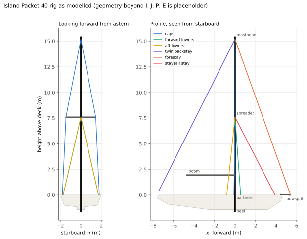
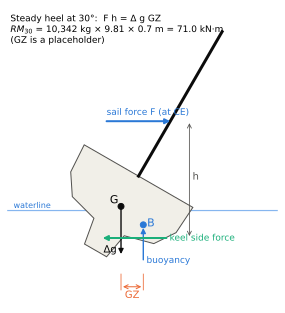
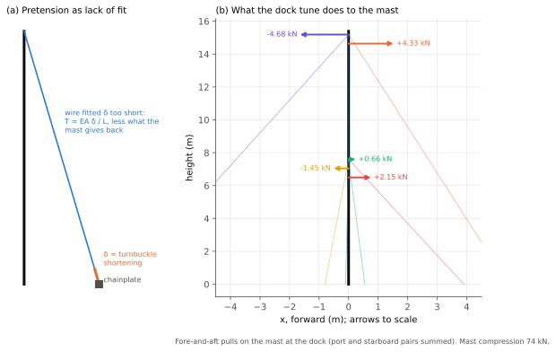
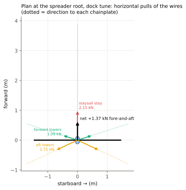
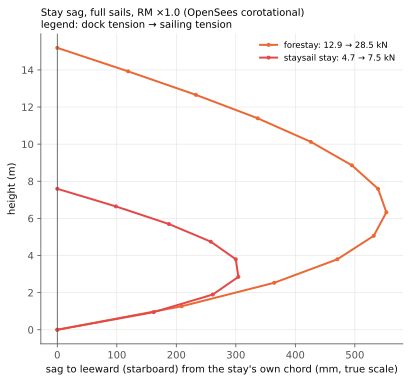
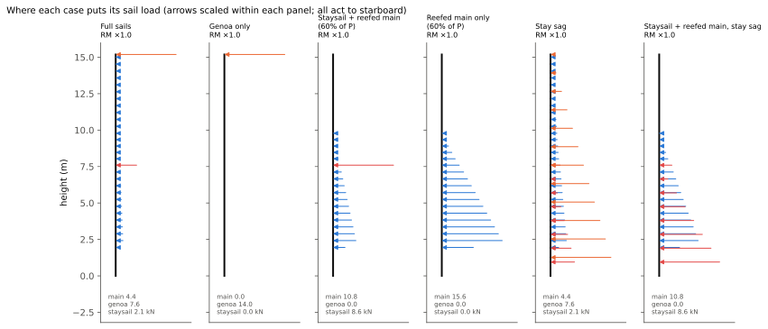
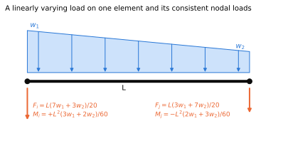
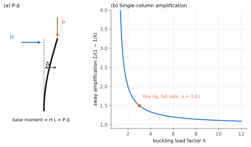
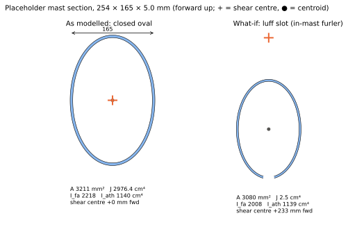

# Island Packet 40 rig 3D analysis: companion notes

This note explains what the notebook
[notebooks/island-packet-40-1996.ipynb](https://github.com/rigframe/rigframe/blob/main/notebooks/island-packet-40-1996.ipynb)
computes and why. It's the IP40 counterpart of the Oceanis 440 note
([Sailboat_rig_3D_Oceanis440_COMPANION.md](Sailboat_rig_3D_Oceanis440_COMPANION.md)), and it covers:

- **The load scenarios** and exactly how each one loads the rig, as point loads, distributed loads or
  enforced displacements, with free-body diagrams.
- **Definitions** of the terms the notebook uses, with the ones new to a cutter rig: staysail stay,
  aft lowers, bow shortening.
- **The equations behind the model,** traced to the textbooks by equation number and printed
  page.
- **Standards and design references** for rigs, with what each one covers and what was checked here.

Every number below comes from the notebook's **default inputs**. $I$, $J$, $P$, $E$, the displacement and
the shroud, lower and backstay wire sizes are published. The mast section, the spreader and chainplate
geometry, the staysail stay, the forestay's size and $GZ_{30}$ are placeholders until the boat is
measured (the notebook's closing list says which matter most). Treat the numbers as an illustration of
the method and of where this rig is sensitive, not as a verdict on it.

**The full numbers** live in [Sailboat_rig_3D_IslandPacket40_REPORT.md](Sailboat_rig_3D_IslandPacket40_REPORT.md),
which the notebook writes on every run (its §13). It breaks down each load case item by item: every wire,
every mast panel, each spreader, the load on each hull fitting, and the key displacements. Each case also
gets a four-panel figure: the deflected rig from astern and in profile, coloured by utilisation, with the
sail loads drawn on; mast stress against height; and every wire's % of MBL. The notebook also writes a
standalone 3D viewer, `islandpacket40_rig_stress_utilisation_3d.html`, and redraws this note's figures, so
they stay in step with the inputs. This note keeps only the headline values.

**Contents**

1. [The rig and its parts](#1-the-rig-and-its-parts)
2. [Where the load comes from: the righting moment](#2-where-the-load-comes-from-the-righting-moment)
3. [The load scenarios](#3-the-load-scenarios)
4. [How the loads are applied in the model](#4-how-the-loads-are-applied-in-the-model)
5. [Analysis concepts and definitions](#5-analysis-concepts-and-definitions)
6. [Equations from the textbooks](#6-equations-from-the-textbooks)
7. [Standards, specifications and design references](#7-standards-specifications-and-design-references)
8. [Where each topic lives in the notebook](#8-where-each-topic-lives-in-the-notebook)

---

## 1. The rig and its parts

*Figure 1. The model's geometry. Left: looking forward from astern. Right: the profile. Spreader,
chainplates, staysail stay and backstay feet are placeholders.*

| Term | Meaning | In the model |
| --- | --- | --- |
| **I** | Height of the forestay attachment above the sheer (deck edge) | 15.19 m (49.83 ft, published) |
| **J** | Mast to forestay tack, along the deck. On the IP40 the tack is at the end of the bowsprit | 5.41 m (17.75 ft, published) |
| **P, E** | Mainsail luff and foot lengths | 13.05 m, 4.72 m (published) |
| **Masthead cutter** | Forestay to the masthead, plus an inner forestay for a staysail. Good Old Boat says "fractional cutter", but $I$ matches the mast height above the sheer | masthead |
| **Staysail stay** (inner forestay, cutter stay) | The inner stay from the foredeck to a tang partway up the mast. The staysail hanks or furls on it | 5/16 in, tack 3.90 m forward, tang 7.59 m up (placeholders) |
| **Caps** (uppers; V1, V2) | Shrouds from the chainplate over the spreader tip to the masthead. V1 is below the tip, V2 above | 3/8 in (published) |
| **Forward and aft lowers** | Two shrouds each side from chainplates forward and aft of the mast to the spreader root. Together they hold the middle of the mast fore-and-aft as well as sideways | 5/16 in (published) |
| **Intermediates** | Shrouds to a second spreader's root. The IP40 has none, which is why the model has one spreader set | none (published) |
| **In-line spreaders** | Spreaders square to the centreline, not swept aft. The caps then hold the mast sideways only | 0° sweep, 1.45 m (placeholders) |
| **Running backstays** | Adjustable stays from the staysail tang to the quarters, set on the windward side. They answer the staysail stay directly. None are listed for the IP40 | none |
| **Twin backstay** | Two backstay legs from the masthead to the transom quarters | 5/16 in each (published) |
| **Partners, heel** | Where a keel-stepped mast passes through the deck, and its foot on the keel | partners fixed in x and y; heel pinned, twist held |
| **Chainplate** | The hull fitting a turnbuckle pins to | each wire has its own, fully fixed |

### Rigging list

Every piece of standing rigging in the model, laid out the way a rigging order is: what it is, how many, the wire, and its length, with the breaking load and the highest load this study puts on it. The cap, lower and backstay sizes are IP Home Port's published figures. The forestay and staysail-stay sizes, and all the geometry behind the lengths, are placeholders.

| Item and where it runs | Qty | Wire, 1x19 316 | Length, centre to centre (each) | Design MBL | Dock tune | Highest load in any case | Size |
| --- | ---: | --- | --- | --- | --- | --- | --- |
| **Forestay (inside the genoa furler)**: bowsprit end to masthead | 1 | 3/8 in (9.5 mm) | 16.12 m (52 ft 11 in) | 64.5 kN (14,500 lbf) | 12.9 kN (20%) | 35.6 kN, SF 1.8 (Stay sag, RM ×1.5) | placeholder |
| **Staysail stay (inner forestay)**: foredeck to its tang | 1 | 5/16 in (7.9 mm) | 8.54 m (28 ft 0 in) | 47.2 kN (10,600 lbf) | 4.7 kN (10%) | 18.6 kN, SF 2.5 (Staysail + reefed main, stay sag, RM ×1.0) | placeholder |
| **Backstay legs (twin)**: transom quarter to the masthead | 2 | 5/16 in (7.9 mm) | 16.53 m (54 ft 3 in) | 47.2 kN (10,600 lbf) | 5.2 kN (11%) | 17.1 kN, SF 2.8 (Stay sag, RM ×1.5) | published |
| **Caps (uppers)**: chainplate, over the spreader tip, to the masthead (one wire) | 2 | 3/8 in (9.5 mm) | 15.33 m (50 ft 4 in) | 64.5 kN (14,500 lbf) | 13.1 kN (20%) | 24.5 kN, SF 2.6 (Genoa only, RM ×1.0) | published |
| **Forward lowers**: chainplate to the spreader root | 2 | 5/16 in (7.9 mm) | 7.81 m (25 ft 7 in) | 47.2 kN (10,600 lbf) | 4.7 kN (10%) | 16.7 kN, SF 2.8 (Staysail + reefed main, RM ×1.0) | published |
| **Aft lowers**: chainplate to the spreader root | 2 | 5/16 in (7.9 mm) | 7.83 m (25 ft 8 in) | 47.2 kN (10,600 lbf) | 7.1 kN (15%) | 27.5 kN, SF 1.7 (Staysail + reefed main, stay sag, RM ×1.0) | published |

**Wire totals by size** (the pieces above, centre-to-centre lengths, before any allowance for terminals):

| Wire | Pieces | Total length | MBL sources in the wire table |
| --- | ---: | --- | ---: |
| 3/8 in (9.5 mm) 1x19 316 | 3 | 46.8 m (154 ft) | 2 |
| 5/16 in (7.9 mm) 1x19 316 | 7 | 72.9 m (239 ft) | 1 |

**Before ordering from this list:**

- **The lengths are not cut lengths.** Each is measured in the model from the mast's centreline at the attachment height to the chainplate pin at deck level, along the wire. A real wire is made to its pin-to-pin length: tang to chainplate, with the turnbuckle and toggles at their working setting. The tangs sit off the centreline and the chainplate pins sit above the deck, so the real length differs by several centimetres even where the geometry is right, and here most of the geometry is a placeholder.
- **Measure the old wire,** pin to pin with its turnbuckle at the tuned setting, or have a rigger measure the spar and chainplates. Use this list for what's needed, the sizes and quantities, and the loads to compare fittings against.
- **Terminals, toggles and turnbuckles aren't in the model.** Size them to match the wire, and check that each fitting's rated load is at least the wire's MBL.
- **MBL is the lowest of the catalogs in the wire table;** where it rests on a single catalog the totals table says so. Use the figure on the new wire's certificate.
- **The highest load** is the largest tension any of this study's cases puts on that wire, on either side, at the placeholder $GZ_{30}$. Port and starboard wires are the same length and see the same loads on opposite tacks.

---

## 2. Where the load comes from: the righting moment

*Figure 2. In a steady heel, the sail's heeling moment equals the hull's righting moment.*

A sailing rig's design load is capped by the hull, not by the wind. The wind can only push on the sails
as hard as the boat resists heeling; push harder and the boat heels further and spills wind. So the load
to design for is the hull's righting moment.

- **Righting moment.** At a heel angle $\phi$, weight acts down through the centre of gravity $G$ and
  buoyancy acts up through the centre of buoyancy $B$, which has moved to leeward. The couple is
  $$RM(\phi) = \Delta\, g\, GZ(\phi)$$
  where $\Delta$ is the displacement (mass) and $GZ$ the horizontal distance between the two lines of
  action, read off the boat's stability curve.
- **$RM_{30}$** is the righting moment at 30° heel, the traditional reference point for rig sizing. The
  notebook assumes $GZ_{30} = 0.70$ m, the same placeholder as for the Oceanis, giving
  $RM_{30} = 10{,}342 \times 9.81 \times 0.70 = 71.0$ kN·m. The IP40 is heavy for its length (22,800 lb)
  with 44% ballast, so its real $GZ_{30}$ could differ either way. Every sailing load scales with it.
- **What the rig carries.** The notebook uses the conservative rule that the moment of the sail force
  about the deck equals $k\,RM_{30}$, with $k$ (`RM_factor`) 1.0 for the steady case and 1.5 for gusts and
  heel past 30°. Measuring the arm from the deck rather than from the keel's centre of lateral resistance
  makes the arm shorter and the force larger.

---

## 3. The load scenarios

Every case starts from the same **dock tune**, and the sailing loads are added on top in one nonlinear
solve. Heel is always to starboard: wind from port, so the **port** (windward) shrouds load up and the
**starboard** (leeward) ones unload.

| Case | What it represents | Sail load on the rig | Notebook |
| --- | --- | --- | --- |
| **Dock tune** | Tied up, no wind; turnbuckle pretension only | none; enforced turnbuckle shortenings | §5 |
| **Full sails, RM ×1.0** | Main, 130% genoa and staysail, steady 30° heel | main: triangular along the mast; each headsail: 1/3 as a point load at its tang | §4, §6 |
| **Full sails, RM ×1.5** | The same with a gust factor | as above, ×1.5 | §10 |
| **Genoa only** | Main and staysail down; the whole moment through the genoa | point load at the masthead | §10 |
| **Staysail + reefed main** | The cutter's heavy-weather rig: genoa furled, main reefed to 60% of P, staysail set | main low on the mast; staysail 1/3 at its tang | §10 |
| **Reefed main only** | Main reefed to 60% of P, no headsail | triangular load over the lower 7.8 m of luff | §10 |
| **Stay sag, ×1.0 and ×1.5** | Full sails, with each headsail's load along its own stay | triangular loads along a 12-segment forestay and an 8-segment staysail stay | §10 |
| **Staysail + reefed main, stay sag** | The heavy-weather rig with the staysail's load along its stay | main as above; staysail along its stay | §10 |

The headline results (OpenSees corotational for the stay-sag cases; the report has every item):

| Case | Windward cap | Fwd lower | Aft lower | Forestay | Staysail stay | Mast compr. | Min SF (wire) | Mast peak | Mast util. |
| --- | ---: | ---: | ---: | ---: | ---: | ---: | --- | ---: | ---: |
| Dock tune | 13.1 kN | 4.7 | 7.1 | 12.9 | 4.7 | 74 kN | 4.9 (cap) | 46 MPa | 19% |
| Full sails ×1.0 | 19.7 | 11.1 | 13.6 | 12.9 | 4.5 | 76 | 3.3 (cap) | 51 | 21% |
| Full sails ×1.5 | 22.8 | 16.6 | 18.8 | 12.7 | 4.5 | 85 | 2.5 (aft lower) | 69 | 29% |
| Genoa only | 24.5 | 8.5 | 10.9 | 12.9 | 4.6 | 74 | 2.6 (cap) | 48 | 20% |
| Staysail + reefed main | 11.7 | 16.7 | 18.9 | 12.7 | 4.6 | 85 | 2.5 (aft lower) | 128 | 53% |
| Reefed main only | 11.1 | 16.1 | 18.3 | 12.7 | 4.6 | 84 | 2.6 (aft lower) | 160 | 67% |
| Stay sag ×1.0 | 18.8 | 8.8 | 17.3 | 28.5 | 7.5 | 105 | 2.3 (forestay) | 78 | 32% |
| Stay sag ×1.5 | 21.6 | 11.5 | 24.0 | 35.6 | 8.8 | 122 | 1.8 (forestay) | 105 | 44% |
| **Staysail + reefed main, stay sag** | 11.3 | 10.0 | **27.5** | 8.0 | **18.6** | 96 | **1.7 (aft lower)** | **166** | **69%** |

The cap column is the upper segment, V2, which runs a little above V1. Mast utilisation is peak stress ÷ an
assumed 240 MPa yield (§3.7).

### 3.1 Dock tune

*Figure 3. (a) Pretension as lack of fit. (b) The fore-and-aft pulls the wires put on the mast at the dock.*

**What it is.** The rig with no wind. Each wire has been tightened with its turnbuckle to a target
tension, measured on its bottom segment, as a percentage of its design breaking load:

| Wire | Target | Set by |
| --- | --- | --- |
| Caps (3/8 in) | 20% MBL (12.9 kN, 2,900 lbf) | cap turnbuckles |
| Forward lowers (5/16 in) | 10% (4.7 kN) | their turnbuckles |
| Aft lowers (5/16 in) | 15% (7.1 kN) | their turnbuckles |
| Staysail stay (5/16 in) | 10% (4.7 kN) | its turnbuckle |
| Forestay (3/8 in) | 20% (12.9 kN) | the backstay adjusters, because the forestay is inside the genoa furler |

These are placeholder targets in the range riggers quote (§7). IP Home Port lists maximum Loos PT-3
readings for this boat (uppers 38–41, lowers 23–26, backstays 26–29, by temperature). Converting them to
pounds needs the table printed on the gauge, which wasn't available, so compare them on the boat.
The dock tune alone puts **74 kN** of compression in the mast.

**How it is modelled.** Pretension is a **lack of fit**: closing a turnbuckle by $\delta$ is the same as
fitting a wire $\delta$ too short. Each wire has its own chainplate node, moved by $\delta$ along the wire
(Pynite, enforced displacement); in OpenSees the same $\delta$ is an initial strain $\delta/L$. A Newton
iteration finds all five turnbuckle settings at once.

*Figure 4. Plan view at the spreader root, dock tune: each wire's horizontal pull on the mast.*

**The staysail stay bows the mast forward.** At the spreader root, three wires pull forward and two pull
aft:

- **Forward:** the staysail stay, 2.15 kN, and the two forward lowers, 0.66 kN between them.
- **Aft:** the two aft lowers, 1.45 kN between them.
- **Net:** 1.37 kN forward, at mid-height. The mast bows forward by about **50 mm** at the spreader, with
  4.0 kN·m of fore-and-aft bending there.

The aft lowers can't fix it, because they're nearly vertical: they lead only **0.10** of their tension aft.
To cancel the forward pull alone, each would need about 13.8 kN, 29% of its MBL. On the Oceanis the pre-bend
came from the swept spreaders; here it comes from the staysail stay. How big it
really is depends on the tang height and the aft lowers' chainplates, both placeholders.

### 3.2 Full sails, RM ×1.0 and ×1.5

A cutter can carry three sails, split **by area** at one pressure $p$:

$$A_m = \tfrac12 P E, \qquad A_g = \tfrac12 I J \cdot \frac{LP}{J}, \qquad A_s = \tfrac12 I_s J_s \cdot \left(\frac{LP}{J}\right)_s$$

$$p = \frac{k\,RM_{30}}{A_m\,\bar z_m + A_g\,I/3 + A_s\,I_s/3}$$

$I_s$ and $J_s$ are the staysail stay's tang height and tack distance, and $LP/J$ = 1.30 for the genoa
(Cruising World's owner report) and 1.0 for the boomed staysail. With the defaults $p = 141$ Pa: the main
carries 4.4 kN, the genoa 7.6 kN and the staysail 2.1 kN.

- **Main:** triangular along the mast from the boom to the head of P, largest at the boom
  ($w_0 = 2F_m/P = 668$ N/m).
- **Headsails:** each is a triangle on its stay with its centroid at a third of the tang height, so
  statics puts 1/3 of its force at the tang and 2/3 at the tack. The tack shares go into the hull. That
  leaves 2.5 kN at the masthead and 0.7 kN at the staysail tang.
- **What happens:** the windward cap's upper segment reaches 19.7 kN (SF 3.3). The leeward forward lower
  goes **slack**, and the leeward aft lower falls to 0.6 kN, so the leeward side of the lower mast is held
  by the cap alone. At ×1.5 the windward aft lower becomes the governing wire (SF 2.5).

### 3.3 Genoa only

The whole moment through the genoa, so the masthead point load is 4.7 kN and nothing loads the mast
below. The caps do the work: 24.5 kN windward, SF 2.6, the highest cap load of any case.

### 3.4 Staysail + reefed main, and reefed main only

**These are the cases that load the lower mast.** With the main reefed to 60% of P, the main's load sits
on 7.8 m of luff, from the boom at 1.95 m up to 9.8 m, most of it below the spreader. Its arm is short, so
its force is large:
15.6 kN with the main alone, 10.8 kN with the staysail (which carries 8.6 kN). The windward aft lower
governs (SF 2.5–2.6), both leeward lowers go slack, and the mast takes up to **160 MPa** at the partners
(reefed main only), with 18.4 kN·m of athwart bending. The single spreader leaves a 7.6 m lower panel
with nothing between the deck and the spreader to share the load.

### 3.5 Stay sag (the longitudinal cases)

*Figure 5. Each stay's sag to leeward from its own chord, full sails at RM ×1.0, true scale.*

**What changes.** In the lumped cases each headsail's load is split between tang and tack. Here it acts
**along** the stay, as a triangular load largest at the tack. A taut cable can only carry a sideways load
by bowing, and a bowed cable is longer than its chord, so the stay stretches and its tension rises:

1. **Equilibrium.** A cable under a sideways load $w$ needs tension $T \approx wL^2/(8d)$ for a sag $d$.
2. **Geometry.** The bowed cable is longer than its chord: $\Delta S \approx 8d^2/(3L)$.
3. **Stretch.** That length can only come from stretching the wire, less whatever the ends move together.

**Full sails.** The forestay sags 553 mm and its tension goes from 12.9 to **28.5 kN**; the rigid-end
cable bound is 31.9 kN, so the masthead gives a little. The staysail stay sags 304 mm and goes from 4.7 to
7.5 kN. The mast's compression rises 38% (76 to 105 kN). At ×1.5 the forestay governs (35.6 kN, SF 1.8).
The forestay's size isn't published, and it's assumed equal to the caps.

**Staysail + reefed main: the governing case of the study.** With the staysail's 8.6 kN along its stay:

- **The staysail stay rises from 4.7 to 18.6 kN** (SF 2.5) and sags 511 mm.
- **Its tang moves 133 mm forward.** That's why the stay stays far below its rigid-end bound of 27.7 kN:
  the mast is the soft end.
- **The windward aft lower reaches 27.5 kN, 58% of MBL, SF 1.71,** the lowest wire margin in the study.
  It pulls its chainplate up with 26.6 kN.
- **The mast peaks at 166 MPa (69%)** at the partners, with 15.6 kN·m fore-and-aft and 14.3 kN·m athwart
  at once.

**Why this happens.** The aft lowers lead only 0.10 of their tension aft. Of the staysail stay's 8.5 kN
forward pull at the tang, they answer about 3 kN while carrying 27.5 kN along their length. The mast's
bending takes the rest. **Running backstays or check stays** are a common answer on a cutter: they pull
aft from the tang at a useful angle. None are listed for the IP40. Two placeholders drive this result, the
tang height and the aft lowers' chainplate positions, so they are the first things to measure.

**Slack is not sag.** A *slack* wire has zero tension and carries nothing (the leeward lowers, often).
A *sagging* wire is tensioned and bowed by a sideways load, and its tension goes up.

**Solver note.** The tension rise comes from second-order stretch, $\tfrac12\int (dy/ds)^2 ds$, which a
linearised P-Delta solve leaves out. Pynite keeps the forestay at its dock tension and lets it sag 1.2 m.
OpenSees's corotational truss tracks exact geometry and gets the rise. The lumped Pynite run of the
heavy-weather case shows the staysail stay at 4.6 kN and misses everything above. Notebook check 9 tests
the cable equation against OpenSees on a single forestay (0.9% apart).

### 3.6 Load cases at a glance

*Figure 6. Where each case puts its sail load. Arrows are scaled within each panel. Blue: the main;
orange: the genoa on the forestay; red: the staysail on its stay.*

### 3.7 Mast and spreader stress

Each mast element's peak stress combines its axial compression with its two bending moments at the
worst point of the section:

$$\sigma_{max} = \frac{|N|}{A} + \sqrt{\left(\frac{M_{fa}\,c_{fa}}{I_{fa}}\right)^2 + \left(\frac{M_{ath}\,c_{ath}}{I_{ath}}\right)^2}$$

- **Section values:** the placeholder oval, 254 × 165 × 5 mm ($A$ = 3,211 mm², $I_{fa}$ = 2,218 cm⁴,
  $I_{ath}$ = 1,140 cm⁴), with $c_{fa} = 127$ mm and $c_{ath} = 82.5$ mm.
- **Why the square root:** it's the peak of two bending stresses around an oval outline, combining
  bending about two axes: two-plane bending, Shigley Eq. (3-27), §3-10, p. 106.
- **Utilisation** is $\sigma_{max}$ ÷ an assumed 240 MPa, the order of 6061-T6 and 6082-T6.

What it shows:

- **At the dock, 46 MPa (19%) at the spreader root.** Half is compression (74 kN on 3,211 mm² is 23 MPa).
  The rest is the staysail stay's 4.0 kN·m of pre-bend.
- **Full sails stay modest:** 51 MPa (21%), 69 MPa (29%) at ×1.5.
- **The reefed cases load the partners:** 128 MPa (53%) with the staysail lumped, 160 MPa (67%) with the
  main alone.
- **The heavy-weather rig with stay sag governs: 166 MPa (69%).** Fore-and-aft bending from the staysail
  stay adds to athwart bending from the reefed main.
- **Spreaders** stay below about 27% on a placeholder airfoil.
- **Pynite and OpenSees agree** on the full-sail peak to 0.3% (check 12).

The section is a placeholder and the yield assumed, so read these as relative. This is an overall-stress
check only. It doesn't cover local wall buckling, the stress concentrations at the spreader root, the
staysail tang and the sheave boxes, or fatigue, which usually decide a spar's details.

### 3.8 What none of the cases include

- **Sheet, halyard and vang loads,** which add mast compression.
- **Pitching inertia and wave slamming** (dynamic loads).
- **Fore-and-aft drive forces** of the sails.
- **Rig self-weight.**
- **Spinnaker, gennaker and broach cases,** which ISO 12215-10 lists (§7).
- **The bowsprit as a structure.** The forestay tack is fixed; the bowsprit, its bobstay and the stem
  fitting aren't modelled. The report gives the load the forestay puts on it.
- **Required safety factors.** The notebook reports SF against MBL; it doesn't apply a standard's
  minimums.

---

## 4. How the loads are applied in the model

| Load | Form | Applied as |
| --- | --- | --- |
| Turnbuckle pretension | enforced displacement $\delta$ along the wire | Pynite: chainplate node displacement; OpenSees: initial strain $\delta/L$ |
| Main | distributed, triangular (or uniform, by switch), on the mast between boom and head of P | consistent nodal loads on each mast element: forces and end couples |
| Genoa, lumped | point load, 1/3 of the genoa force | at the masthead node; the 2/3 tack share goes to the hull |
| Staysail, lumped | point load, 1/3 of the staysail force | at the staysail tang node; the 2/3 tack share goes to the hull |
| Headsails, stay sag | distributed, triangular, along each stay | consistent nodal forces on 12 forestay and 8 staysail-stay segments |
| Supports | heel pinned with twist held; partners hold x and y; chainplates, bowsprit end, staysail tack and backstay feet fully fixed | reactions checked against applied loads (check 5) |

### Consistent nodal loads

*Figure 7. A linearly varying load on one element and its equivalent nodal loads.*

A frame model only takes loads at nodes, so each element's distributed load is replaced by the nodal
forces and couples that do the same work. For a load varying linearly from $w_1$ at node $i$ to $w_2$ at
node $j$ over length $L$:

$$F_i = \frac{L(7w_1 + 3w_2)}{20}, \quad F_j = \frac{L(3w_1 + 7w_2)}{20}, \quad
M_i = +\frac{L^2(3w_1 + 2w_2)}{60}, \quad M_j = -\frac{L^2(2w_1 + 3w_2)}{60}$$

For a uniform load they reduce to $wL/2$ and $\pm wL^2/12$, the negatives of the fixed-end moments
tabulated in Hibbeler's *Structural Analysis* (§6). A cable has no bending stiffness, so the stay segments
get forces only: $L(2w_1+w_2)/6$ and $L(w_1+2w_2)/6$.

---

## 5. Analysis concepts and definitions

### Elements and members

- **Frame element.** A beam with axial force, shear, bending about two axes and torsion; six DOF per node.
  Used for the mast and spreaders.
- **Truss (or cable) element.** Axial force only. Used for the wires.
- **Tension-only member.** A wire can't push; the solver drops any wire that would go into compression.
- **End release.** The spreader roots are released in the vertical plane, so the wire geometry, not
  spreader bending, carries the vertical load at the tip.
- **Effective modulus of a strand.** $E_{eff} = 107.5$ GPa on the gross area (S3i); a strand stretches more
  than a solid rod because its wires are helices.

### Pretension terms

- **Pretension, dock tune.** The tension a wire carries with no external load.
- **Lack of fit.** A member fitted too long or too short; Hibbeler's *Structural Analysis* §14.8 treats
  it in the stiffness method as the notebook does (§6).
- **Pre-bend.** A forward bow in the middle of the mast. On this rig the staysail stay pulls it in at the
  dock (§3.1).
- **MBL, design MBL, SF.** Minimum breaking load; the design MBL is the lowest of the catalogs in the
  wire table. For 5/16 in only one catalog (Lexco) lists 316, so that figure is the least certain.

### Geometric nonlinearity

*Figure 8. P-Delta, and how much the second-order effect amplifies sway for a single column.*

- **P-Delta (P-Δ).** Equilibrium on the deformed shape: an axial load $P$ acting through a sway $\Delta$
  adds a moment $P\Delta$.
- **Geometric stiffness, $K_g$.** The matrix that carries those effects in a finite-element solve. A taut
  wire's $K_g$ gives it a sideways string stiffness $T/L$.
- **Amplification.** For a single column, sway grows roughly as $1/(1 - 1/\lambda)$: 1.5 at this rig's
  $\lambda = 3.0$. The rig shows only 0.7% more masthead sway than a linear run, because the wires'
  string stiffness offsets most of the mast's softening.
- **Two-cycle P-Delta.** Pynite 1.0.1's `analyze_PDelta` updates $K_g$ twice and stops. It agrees with
  OpenSees corotational to under 1% on every wire except the forestay.
- **Bow shortening.** A bent member's chord is shorter than its length by about
  $\tfrac12\int (du/dz)^2\,dz$. The 50 mm dock pre-bend shortens the mast's chord by about 0.7 mm, which
  lowers the masthead and takes about 0.3 kN out of the forestay. Linear-strain elements can't see it, so
  Pynite's forestay runs 1.8% above OpenSees's. It's the same second-order term as stay sag, in a
  compression member.
- **Corotational formulation.** Each element's deformation is measured in a frame that moves with it, so
  large rotations and these second-order lengths are exact. OpenSees's `Corotational` and `corotTruss` do
  this; they're the reference.

### Buckling

- **Euler buckling.** $P_{cr} = \pi^2 EI/(KL)^2$ (§6).
- **Linear buckling eigenvalue, λ.** The factor by which the whole current stress state would have to grow
  for the structure to buckle. The defaults give λ ≈ 3.0, flexural, at the dock and sailing alike.
- **Panel buckling.** The pinned-panel Euler estimate for the 7.6 m lower panel is only 1.8 times its
  compression. It's a floor, not a prediction: the mast is continuous over the spreader. A single-spreader
  rig spends its buckling margin on long panels, so it generally needs a stiffer section than a
  two-spreader rig on the same boat.

### Section properties and torsion

*Figure 9. The placeholder section, and the slotted what-if for an in-mast furler.*

- **The section is a placeholder:** a closed oval, 254 × 165 mm, 5 mm wall, 8.7 kg/m. The IP40's
  standard main sets on a track, so the tube is closed.
- **St-Venant torsion constant, $J$.** About 2,980 cm⁴ for the closed oval. Check 11 tests it against
  Bredt's thin-wall formula $J = 4A_m^2 / \oint ds/t$. The wall of an elliptical tube with an elliptical
  bore isn't uniform (4.88–5.00 mm here), and using the measured $t(s)$ matters: with a uniform $t$ the
  formula would be 1.2% off, and with the real one it agrees to 0.008%.
- **Shear centre.** At the centroid for the closed oval, so torsional-flexural buckling reduces to Euler.
- **The slotted what-if.** Cutting a 26 mm luff slot drops $J$ to 2.5 cm⁴ and moves the shear centre
  233 mm forward. Its torsional-flexural load in the lower panel is then only 0.54 times the compression:
  it would fail. That's the same lesson as the Oceanis's plain-oval estimate. An in-mast furling mast
  needs internal walls like the Z900E's.

---

## 6. Equations from the textbooks

Printed pages throughout. Editions are the ones in this folder. This is the same set the Oceanis note
traced; the IP40 model uses the same mechanics.

| Topic | Equation | Source |
| --- | --- | --- |
| Euler column, pinned ends | $P_{cr} = \pi^2 EI/l^2$ | Shigley 10th ed., Eq. (4-42), §4-12, p. 195 |
| Other end conditions | $P_{cr} = C\pi^2 EI/l^2$ | Shigley Eq. (4-43), p. 195 (end-condition constants in Fig. 4-18) |
| Euler column | $P_{cr} = \pi^2 EI/L^2$ | Hibbeler *Mechanics of Materials* 8th ed., Eq. (13-5), p. 663 |
| Effective length | $L_e = KL$, $P_{cr} = \pi^2 EI/(KL)^2$ | Hibbeler MoM Eqs. (13-10), (13-11), p. 667 |
| Eccentric column, max deflection | $v_{max} = e\left[\sec\left(\sqrt{P/EI}\,L/2\right) - 1\right]$ | Hibbeler MoM Eq. (13-16), p. 679: the amplification behind P-Delta |
| Secant formula | $\sigma_{max} = \frac{P}{A}\left[1 + \frac{ec}{r^2}\sec\left(\frac{L}{2r}\sqrt{\frac{P}{EA}}\right)\right]$ | Hibbeler MoM Eq. (13-19), p. 681; Shigley Eq. (4-50), p. 199 |
| Two-plane bending | $\sigma_x = -\frac{M_z y}{I_z} + \frac{M_y z}{I_y}$, the basis of the mast-stress formula in §3.7 | Shigley Eq. (3-27), §3-10, p. 106 |
| Thin-walled closed section | $\tau = T/(2A_m t)$, angle of twist from Eq. (3-46) | Shigley Eqs. (3-45), (3-46), pp. 122–123: the basis of check 11 |
| Thin-walled open section | $\tau = G\theta_1 c = 3T/(Lc^2)$ | Shigley Eq. (3-47), p. 123, with the slit-tube comparison |
| Shear centre | location for thin-walled open sections | Beer *Mechanics of Materials* 6th ed., §6.9, p. 414 |
| Cable under distributed load | $F_H = \frac{w_0L^2}{2h}$, $T_{max} = \sqrt{F_H^2 + (w_0L)^2}$ | Hibbeler *Structural Analysis* 8th ed., §5.3, Eqs. (5-1) to (5-11), pp. 184–185 |
| Lack of fit in the stiffness method | member fabrication errors as initial forces | Hibbeler *Structural Analysis* §14.8, p. 564 |
| Frame member stiffness | the 12×12 member matrix | Hibbeler *Structural Analysis* §16.1, p. 595 |
| Fixed-end moments | $wL^2/12$ etc., the basis of consistent loads | Hibbeler *Structural Analysis*, table inside the back cover |
| Statically indeterminate axial members | compatibility plus equilibrium, as in the two-wire pretension check | Hibbeler MoM §4.4, p. 137 |
| Wire rope | rope modulus $E_r$ versus wire modulus; static factor of safety | Shigley §17-6 *Wire Rope*, pp. 908–915 |

**Not from those books** (references in §7): the cable equation with elastic stretch (Irvine), the
torsional-flexural formula (Timoshenko & Gere; AISC 360 §E4), Bredt's formula with variable thickness
$J = 4A_m^2/\oint ds/t$ (the general form of Shigley's thin-walled result), the bow-shortening integral,
and the sag-length approximation $\Delta S \approx 8d^2/(3L)$.

---

## 7. Standards, specifications and design references

**Status key.** *Read* means the content was read for this work. *Confirmed* means its existence and scope
were checked, but its text was not read. *Cited* means it's known from secondary sources only.

### Rig design standards and books

| Reference | Covers | Status |
| --- | --- | --- |
| **ISO 12215-10:2020**, *Rig loads and rig attachment in sailing craft* | Design loads on rig elements, chainplates and mast steps up to 24 m, including maximum righting moment, spinnaker and broach cases | Confirmed (for the Oceanis note); paywalled. [ISO](https://www.iso.org/standard/67294.html) |
| **ISO 12217-2**, stability of sailing boats 6 m and over | The stability assessment that would give the real $RM_{30}$ | Cited |
| **Nordic Boat Standard** (1990) | The $RM_{30}$-based rig dimensioning method, including cutter and staysail cases | Cited, through Larsson & Eliasson |
| Larsson, Eliasson & Orych, ***Principles of Yacht Design*** | Rig design and construction chapters; foresail-only and reefed cases | Confirmed (chapter list); not read |
| Irvine, ***Cable Structures*** | The elastic cable equation behind the stay-sag bound | Cited |
| Timoshenko & Gere, ***Theory of Elastic Stability***; AISC 360 §E4 | Torsional-flexural buckling | Cited |

### Tuning and practice

| Reference | Covers | Status |
| --- | --- | --- |
| Loos & Co., *How to use 90 & 91 Series Tension Gauges* | Suggested starting tensions; about 15% of breaking strength on a masthead forestay; "roller furling can only be set by back stay tension"; leeward shrouds shouldn't go slack in a brisk breeze | Read. [Loos](https://loosnaples.com/how-tos/tension-gauges/90-91/) |
| Loos PT-3 gauge | Covers 1/4–3/8 in cable; pound scale calibrated for 302/304 1x19, so its percent-of-breaking scale overstates the margin on 316 | Confirmed through retailer listings; the conversion table on the gauge wasn't seen |
| IP Home Port, IP40 standing-rigging table | Maximum PT-3 readings for uppers, lowers and backstays | Read. [IP Home Port](https://iphomeport.com/forum/model_info.php?ip_model=IP40); an owners' site, not affiliated with Island Packet |

### Boat data

| Reference | Covers | Status |
| --- | --- | --- |
| Good Old Boat sail data, Island Packet 40 | I, J, P, E; displacement 22,800 lb; ballast 10,000 lb; "fractional cutter"; 1994–2000, 139 hulls | Read. [Good Old Boat](https://goodoldboat.com/saildata/boat/island-packet-40/) |
| IP Home Port, IP40 model page | LOA, LOD, LWL, beam, draft, displacement, mast height 53'8", I, J, P, E, wire sizes, running rigging | Read. [IP Home Port](https://iphomeport.com/forum/model_info.php?ip_model=IP40) |
| *Cruising World*, Island Packet 40 | Dimensions, 22,280 lb, 10,000 lb ballast, 130% genoa as the most-used headsail, staysail on a Hoyt boom | Read. [Cruising World](https://www.cruisingworld.com/sailboats/island-packet-40/) |
| Broker listing, 1998 Island Packet 40 | "cutter rig with keel-stepped mast" | Seen in search results only |

### Wire specifications

The same four catalogs as the Oceanis notebook (Lindemann, S3i, Nance & Underwood, Lexco), in
`Rigging_wire_1x19_316_reference.csv`. Only Nance & Underwood and Lexco list inch sizes.

### Software

| Tool | Used for |
| --- | --- |
| [Pynite](https://github.com/JWock82/Pynite) 1.0.1 | 3D frame, tension-only wires, P-Delta, `K` and `Kg` for buckling |
| [OpenSeesPy](https://openseespydoc.readthedocs.io/) 3.8 | Corotational cross-check, initial-strain pretension, stay sag. Free for research, education and internal use; not OSI open source |
| [sectionproperties](https://sectionproperties.readthedocs.io/) 3.10 | The placeholder section: $A$, $I$, $J$, $C_w$, shear centre |
| [Plotly](https://plotly.com/javascript/) 2.35 | The standalone 3D viewer, loaded from a CDN |

---

## 8. Where each topic lives in the notebook

| Topic | Notebook section | Checks |
| --- | --- | --- |
| Inputs and placeholders | §0 `RigParams` | |
| 1x19 316 wire table | §1 | |
| Mast section (placeholder oval, slotted what-if) | §2 | 1a, 1b, 11 |
| Geometry, spreader-tip check | §3 | |
| Sailing loads, consistent nodal loads | §4 | 6, 10 |
| Pynite model, five-turnbuckle dock tune | §5 | 4, 7 |
| Tensions and safety factors | §6 | 5 |
| Mast bend, pre-bend, linear vs P-Delta | §7 | |
| Buckling, torsional-flexural check | §8 | 3 |
| OpenSees cross-check, bow shortening | §9 | 2b, 8 |
| All load cases side by side; mast and spreader stress | §10 | 9, 12 |
| Interactive explorer (spreader length, staysail tang height, tune, $GZ_{30}$, sail plan) | §11 | |
| Checks table | §12 | all 30 |
| The item-by-item report ([REPORT.md](Sailboat_rig_3D_IslandPacket40_REPORT.md)) and per-case figures | §13 | |
| The standalone 3D viewer (`islandpacket40_rig_stress_utilisation_3d.html`) | §14 | |
| This note's figures | §15 | |
