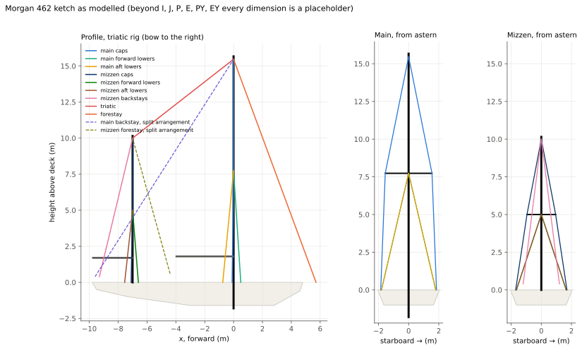
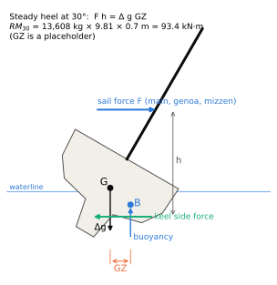
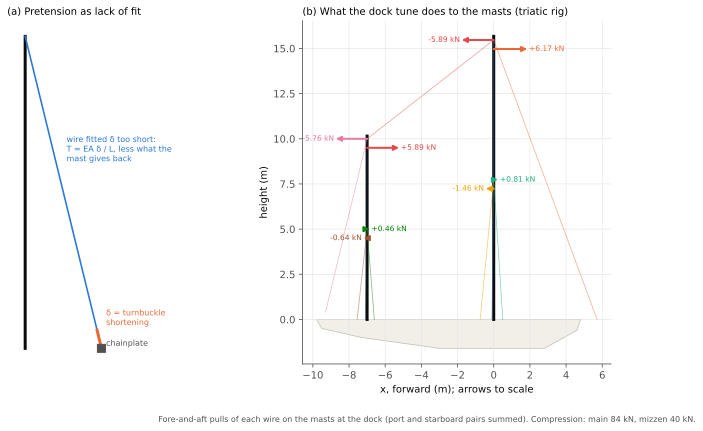
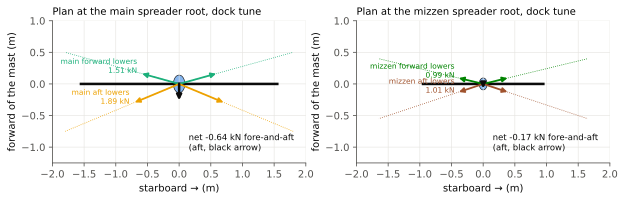
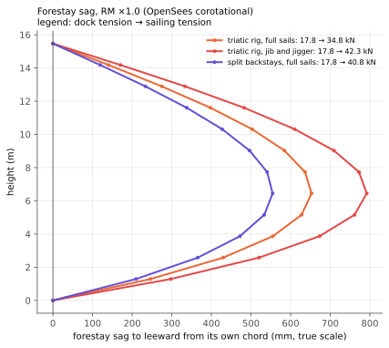
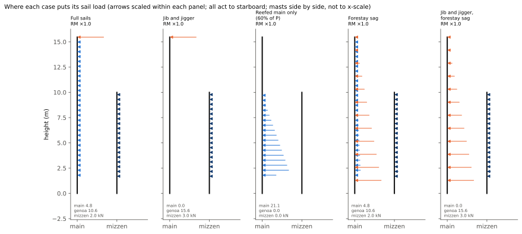
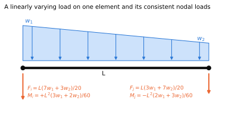
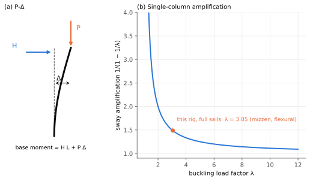
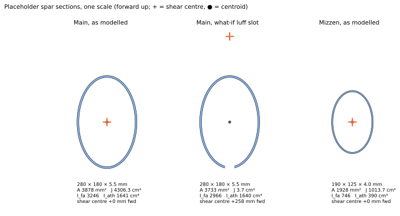

# Morgan 462 ketch rig 3D analysis: companion notes

This note explains what the notebook
[notebooks/morgan-462-ketch.ipynb](https://github.com/rigframe/rigframe/blob/main/notebooks/morgan-462-ketch.ipynb) computes and
why. It's the third in the set, after the Oceanis 440 sloop
([companion](Sailboat_rig_3D_Oceanis440_COMPANION.md)) and the Island Packet 40 cutter
([companion](Sailboat_rig_3D_IslandPacket40_COMPANION.md)). It covers:

- **The load scenarios** and how each one loads the rig, with free-body diagrams.
- **What's new on a ketch:** two masts, and the question of how they hold each other up, by a triatic stay or
  with split backstays.
- **Definitions** of the terms the notebook uses.
- **The equations behind the model,** traced to the textbooks by equation number and printed page.
- **Standards and design references,** each marked read, confirmed or cited.

**How much of this boat is known.** $I$, $J$, $P$, $E$, the mizzen's $P_Y$ and $E_Y$, and the displacement are
published. **Nothing about the spars or standing rigging is.** No public source gives the spreader count, mast
steps, wire sizes, the mizzen's position or height, or whether the boats carried a triatic. So the model's whole
rig is a placeholder: the main copies the IP40's layout (one spreader set, caps, fore and aft lowers), and the
mizzen gets the same layout, smaller. Read the numbers as a study of how a ketch of this size and type behaves,
and of where it's sensitive. They're not a verdict on any particular Morgan 462.

**The full numbers** live in [Sailboat_rig_3D_Morgan462_REPORT.md](Sailboat_rig_3D_Morgan462_REPORT.md), which the
notebook writes on every run, with a four-panel figure per case. The notebook also writes a standalone 3D viewer,
`morgan462_rig_stress_utilisation_3d.html`, and redraws this note's figures, so they stay in step with the inputs.
This note keeps only the headline values.

**Contents**

1. [The rig and its parts](#1-the-rig-and-its-parts)
2. [Where the load comes from: the righting moment](#2-where-the-load-comes-from-the-righting-moment)
3. [The load scenarios](#3-the-load-scenarios)
4. [How the loads are applied in the model](#4-how-the-loads-are-applied-in-the-model)
5. [Analysis concepts and definitions](#5-analysis-concepts-and-definitions)
6. [Equations from the textbooks](#6-equations-from-the-textbooks)
7. [Standards, specifications and design references](#7-standards-specifications-and-design-references)
8. [Where each topic lives in the notebook](#8-where-each-topic-lives-in-the-notebook)

---

## 1. The rig and its parts

*Figure 1. The model's geometry. Left: the profile, with the triatic (solid) and the split arrangement's wires
(dashed). Right: each mast from astern. Everything beyond the published sail dimensions is a placeholder.*

| Term | Meaning | In the model |
| --- | --- | --- |
| **I, J, P, E** | Forestay height, mast to forestay tack, main luff and foot | 15.47, 5.72, 13.18, 3.96 m (published) |
| **$P_Y$, $E_Y$** | Mizzen luff and foot | 8.08, 2.74 m (published) |
| **Ketch** | Two masts, the shorter (mizzen) aft of the main but forward of the rudder post. On a centre-cockpit boat like the 462 it usually stands just aft of the cockpit | mizzen 7.0 m aft of the main, masthead 10.0 m above deck (placeholders) |
| **Triatic stay** | A wire from the main masthead to the mizzen masthead. The main has no backstay of its own: the mizzen's backstays hold the triatic, and the triatic holds the main | 5/16 in (placeholder), the default arrangement |
| **Split main backstays** | The alternative: two backstay legs from the main masthead passing either side of the mizzen to the quarters. The masts then stand independently, and the mizzen needs its own forestay | 3/8 in legs, and a 1/4 in mizzen forestay to the cockpit's forward end (placeholders) |
| **Mizzen backstays** | Two legs from the mizzen masthead to the quarters | 5/16 in (placeholder) |
| **Caps, fore and aft lowers** | On both masts: caps over the spreader tip to the masthead, lowers to the spreader root | main 7/16 in caps, 3/8 in lowers; mizzen 1/4 in (placeholders) |
| **Mast steps** | Main keel-stepped (heel pinned, partners hold it sideways); mizzen deck-stepped (pinned at the deck) | placeholders |
| **Jib and jigger** | Sailing on genoa and mizzen with the main down: the ketch's usual rig for a blow | a §10 case |

### Rigging list

Every piece of standing rigging in the model, laid out the way a rigging order is: what it is, how many, the wire, and its length, with the breaking load and the highest load this study puts on it. Nothing about this boat's spars or rigging is published, so every size and every length here is a placeholder. The main table is the triatic rig; the split-backstay alternative is listed after it.

| Item and where it runs | Qty | Wire, 1x19 316 | Length, centre to centre (each) | Design MBL | Dock tune | Highest load in any case | Size |
| --- | ---: | --- | --- | --- | --- | --- | --- |
| **Forestay (inside the genoa furler)**: stem fitting to masthead | 1 | 7/16 in (11.1 mm) | 16.49 m (54 ft 1 in) | 89.0 kN (20,000 lbf) | 17.8 kN (20%) | 42.7 kN, SF 2.1 (Forestay sag, RM ×1.5) | placeholder |
| **Triatic**: masthead to mizzen masthead | 1 | 5/16 in (7.9 mm) | 8.88 m (29 ft 2 in) | 47.2 kN (10,600 lbf) | 7.5 kN (16%) | 17.8 kN, SF 2.7 (Forestay sag, RM ×1.5) | placeholder |
| **Main caps (uppers)**: chainplate, over the spreader tip, to the masthead (one wire) | 2 | 7/16 in (11.1 mm) | 15.63 m (51 ft 3 in) | 89.0 kN (20,000 lbf) | 18.2 kN (20%) | 32.0 kN, SF 2.8 (Full sails, RM ×1.5) | placeholder |
| **Main forward lowers**: chainplate to the spreader root | 2 | 3/8 in (9.5 mm) | 7.96 m (26 ft 1 in) | 64.5 kN (14,500 lbf) | 6.4 kN (10%) | 21.4 kN, SF 3.0 (Reefed main only, RM ×1.0) | placeholder |
| **Main aft lowers**: chainplate to the spreader root | 2 | 3/8 in (9.5 mm) | 7.98 m (26 ft 2 in) | 64.5 kN (14,500 lbf) | 7.7 kN (12%) | 22.7 kN, SF 2.8 (Forestay sag, RM ×1.5) | placeholder |
| **Mizzen backstay legs**: quarter to the mizzen masthead | 2 | 5/16 in (7.9 mm) | 9.94 m (32 ft 8 in) | 47.2 kN (10,600 lbf) | 12.5 kN (26%) | 30.6 kN, SF 1.5 (Forestay sag, RM ×1.5) | placeholder |
| **Mizzen caps**: chainplate, over the mizzen spreader tip, to the mizzen masthead (one wire) | 2 | 1/4 in (6.3 mm) | 10.15 m (33 ft 3 in) | 30.7 kN (6,900 lbf) | 4.6 kN (15%) | 4.9 kN, SF 6.2 (Full sails, RM ×1.5) | placeholder |
| **Mizzen forward lowers**: chainplate to the mizzen spreader root | 2 | 1/4 in (6.3 mm) | 5.28 m (17 ft 4 in) | 30.7 kN (6,900 lbf) | 3.1 kN (10%) | 5.1 kN, SF 6.0 (Forestay sag, RM ×1.5) | placeholder |
| **Mizzen aft lowers**: chainplate to the mizzen spreader root | 2 | 1/4 in (6.3 mm) | 5.29 m (17 ft 4 in) | 30.7 kN (6,900 lbf) | 3.1 kN (10%) | 5.1 kN, SF 6.0 (Full sails, RM ×1.5) | placeholder |

**Wire totals by size** (the pieces above, centre-to-centre lengths, before any allowance for terminals):

| Wire | Pieces | Total length | MBL sources in the wire table |
| --- | ---: | --- | ---: |
| 7/16 in (11.1 mm) 1x19 316 | 3 | 47.7 m (157 ft) | 1 |
| 3/8 in (9.5 mm) 1x19 316 | 4 | 31.9 m (105 ft) | 2 |
| 5/16 in (7.9 mm) 1x19 316 | 3 | 28.8 m (94 ft) | 1 |
| 1/4 in (6.3 mm) 1x19 316 | 6 | 41.4 m (136 ft) | 2 |

**Split-backstay alternative.** Without the triatic, the rig drops the triatic and adds these:

| Item and where it runs | Qty | Wire, 1x19 316 | Length, centre to centre (each) | Design MBL | Dock tune | Highest load in any case | Size |
| --- | ---: | --- | --- | --- | --- | --- | --- |
| **Main backstay legs**: quarter to the masthead, passing outside the mizzen | 2 | 3/8 in (9.5 mm) | 17.95 m (58 ft 11 in) | 64.5 kN (14,500 lbf) | 5.5 kN (9%) | 16.2 kN, SF 4.0 (Split backstays: Forestay sag, RM ×1.0) | placeholder |
| **Mizzen forestay**: cockpit's forward end to the mizzen masthead | 1 | 1/4 in (6.3 mm) | 9.75 m (32 ft 0 in) | 30.7 kN (6,900 lbf) | 3.7 kN (12%) | 3.7 kN, SF 8.3 (Split backstays: Full sails, RM ×1.0) | placeholder |

**Before ordering from this list:**

- **The lengths are not cut lengths.** Each is measured in the model from the mast's centreline at the attachment height to the chainplate pin at deck level, along the wire. A real wire is made to its pin-to-pin length: tang to chainplate, with the turnbuckle and toggles at their working setting. The tangs sit off the centreline and the chainplate pins sit above the deck, so the real length differs by several centimetres even where the geometry is right, and here most of the geometry is a placeholder.
- **Measure the old wire,** pin to pin with its turnbuckle at the tuned setting, or have a rigger measure the spar and chainplates. Use this list for what's needed, the sizes and quantities, and the loads to compare fittings against.
- **Terminals, toggles and turnbuckles aren't in the model.** Size them to match the wire, and check that each fitting's rated load is at least the wire's MBL.
- **MBL is the lowest of the catalogs in the wire table;** where it rests on a single catalog the totals table says so. Use the figure on the new wire's certificate.
- **The highest load** is the largest tension any of this study's cases puts on that wire, on either side, at the placeholder $GZ_{30}$. Port and starboard wires are the same length and see the same loads on opposite tacks.

---

## 2. Where the load comes from: the righting moment

*Figure 2. In a steady heel, the sails' heeling moment equals the hull's righting moment.*

A rig's design load is capped by the hull: the wind can only push on the sails as hard as the boat resists
heeling. So the load to design for is the righting moment,
$$RM(\phi) = \Delta\, g\, GZ(\phi)$$
with $\Delta$ the displacement and $GZ$ the righting arm. The notebook assumes $GZ_{30} = 0.70$ m, the same
placeholder as the other studies, so $RM_{30} = 13{,}608 \times 9.81 \times 0.70 = 93.4$ kN·m. The Morgan 462 is heavy
(30,000 lb) with a modest 28% ballast ratio, so its real $GZ_{30}$ could well be lower; every sailing load scales with
it. One published table gives 33,000 lb, which would raise $RM_{30}$ by 10%.

The rig must carry a sail force whose moment about the deck is $k\,RM_{30}$, with $k$ = 1.0 for the steady case
and 1.5 for gusts and heel past 30°.

---

## 3. The load scenarios

Every case starts from a dock tune, and the sailing loads go on top in one nonlinear solve. Heel is always to
starboard, so the **port** (windward) shrouds load up.

| Case | What it represents | Sail load on the rig | Notebook |
| --- | --- | --- | --- |
| **Dock tune** | No wind; turnbuckle pretension only | none | §5 |
| **Full sails, ×1.0 and ×1.5** | Genoa, main and mizzen | main and mizzen triangular along their masts; genoa 1/3 at the masthead | §4, §10 |
| **Jib and jigger** | Genoa and mizzen, main down | genoa at the masthead, mizzen on the mizzen | §10 |
| **Reefed main only** | Main reefed to 60% of P | triangular over 7.9 m of luff | §10 |
| **Forestay sag, ×1.0 and ×1.5** | Full sails with the genoa's load along the forestay | triangular along a 12-segment forestay | §10 |
| **Jib and jigger, forestay sag** | The blow rig with the genoa along the forestay | as above, no main | §10 |
| **Split backstays: dock, full sails, forestay sag** | The same boat with no triatic | as the triatic cases | §10 |

Headline results (OpenSees corotational for the sag cases; the report has every item):

| Case | Main cap | Aft lower | Forestay | Triatic | Mizzen backstay | Main / mizzen compr. | Min SF (wire) | Main / mizzen peak |
| --- | ---: | ---: | ---: | ---: | ---: | --- | --- | --- |
| Dock tune | 18.2 kN | 7.7 | 17.8 | 7.5 | 12.5 | 84 / 40 kN | 3.8 (mizzen backstay) | 18% / 16% |
| Full sails ×1.0 | 27.4 | 14.6 | 17.8 | 7.5 | 12.7 | 85 / 40 | 3.2 (cap) | 21% / 17% |
| Full sails ×1.5 | 32.0 | 20.3 | 17.7 | 7.4 | 12.8 | 95 / 40 | 2.8 (cap) | 26% / 20% |
| Jib and jigger | 31.0 | 12.5 | 17.8 | 7.5 | 12.8 | 84 / 40 | 2.9 (cap) | 18% / 20% |
| Reefed main only | 15.8 | 22.3 | 17.7 | 7.4 | 12.4 | 98 / 40 | 2.9 (aft lower) | **67%** / 16% |
| Forestay sag ×1.0 | 26.8 | 16.6 | 34.8 | 14.5 | 24.6 | 105 / 56 | 1.9 (mizzen backstay) | 23% / 33% |
| Forestay sag ×1.5 | 30.9 | 22.7 | 42.7 | 17.8 | **30.6** | 121 / 63 | **1.5 (mizzen backstay)** | 29% / **46%** |
| Jib and jigger, sag | 30.2 | 14.4 | 42.3 | 17.5 | 30.1 | 110 / 63 | 1.6 (mizzen backstay) | 25% / 44% |
| Split: full sails | 26.0 | 13.9 | 17.8 | — | 1.9 | 89 / 28 | 3.4 (cap) | 21% / 13% |
| Split: forestay sag | 24.9 | 13.8 | 40.8 | — | 1.9 | 118 / 27 | 2.2 (forestay) | 24% / 13% |

The cap column is the windward upper segment. In the split rows the main backstay carries 8.8 and 16.2 kN. Spar
utilisation is peak stress ÷ an assumed 240 MPa yield (§3.7).

### 3.1 Dock tune: how the triatic carries the forestay

*Figure 3. (a) Pretension as lack of fit. (b) The fore-and-aft pulls each wire puts on the two masts at the dock.*

| Wire | Target | Set by |
| --- | --- | --- |
| Main caps (7/16 in) | 20% MBL (17.8 kN, 4,000 lbf) | cap turnbuckles |
| Main forward / aft lowers (3/8 in) | 10% / 12% | their turnbuckles |
| Mizzen caps (1/4 in) | 15% (4.6 kN) | their turnbuckles |
| Mizzen forward / aft lowers (1/4 in) | 10% | their turnbuckles |
| Forestay (7/16 in) | 20% (17.8 kN) | the **mizzen backstays**, through the triatic |

The forestay pulls the main masthead forward with 6.2 kN. The triatic pulls it aft with 5.9 kN, and the main's caps
and bending make up the rest. At the other end the triatic pulls the **mizzen** masthead forward with 5.9 kN, and
the mizzen backstays hold it. They're steep, leading only about 0.23 of their tension aft, so each carries 12.5 kN
(26% of MBL) to hold a 7.5 kN triatic. That makes them the most loaded wires in the rig at the dock.

**The mizzen is the soft link.** Its masthead moves 111 mm aft under the tune and it bows about 25 mm aft at
mid-height. The main masthead follows it, 94 mm aft. The dock tune puts 84 kN of compression in the main and
40 kN in the mizzen.

*Figure 4. Plan views at both spreader roots, dock tune: each lower's horizontal pull.*

### 3.2 Full sails, RM ×1.0 and ×1.5

The sails share one pressure, split by area:

$$A_m = \tfrac12 P E, \qquad A_g = \tfrac12 I J \cdot \frac{LP}{J}, \qquad A_z = \tfrac12 P_Y E_Y, \qquad
p = \frac{k\,RM_{30}}{A_m\,\bar z_m + A_g\,I/3 + A_z\,\bar z_z}$$

With $LP/J = 1.30$, $p = 184$ Pa: the main carries 4.8 kN, the genoa 10.6 kN (3.5 kN of it at the masthead) and
the mizzen 2.0 kN. The main caps govern (27.4 kN, SF 3.2), the leeward forward lower goes slack, and the mizzen
barely notices: the genoa's masthead share goes into the main's caps.

### 3.3 Jib and jigger, and reefed main only

**Jib and jigger** puts 15.6 kN on the genoa and 3.0 kN on the mizzen. Most of the moment arrives at the main
masthead, so the main caps take 31.0 kN (SF 2.9). **Reefed main only** brings the whole moment in low on the main:
21.1 kN of sail force, most of it on the 7.7 m lower panel, 24 kN·m of athwart bending at the partners and
**160 MPa, 67% of the assumed yield**, the highest main-mast stress of any case.

### 3.4 Forestay sag: where the triatic sends the load

*Figure 5. The forestay's sag to leeward from its own chord, at RM ×1.0, true scale, for three cases.*

A taut stay can only carry a sideways load by bowing, and a bowed stay is longer than its chord, so it stretches
and its tension rises. With full sails the forestay goes from 17.8 to **34.8 kN** (the rigid-end cable bound is
44.3 kN; the mastheads give a lot). On a ketch with a triatic, that rise has only one way to the hull:

1. **The triatic** takes the main masthead's extra pull aft: 7.5 to 14.5 kN.
2. **The mizzen masthead** is pulled forward, 106 mm, and the main's 120 mm, from their dock positions.
3. **The mizzen backstays** take it all: 12.7 to **24.6 kN, SF 1.9.** The mizzen's compression rises from 40 to
   56 kN and its stress to 79 MPa (33%).

At RM ×1.5 the mizzen backstays reach **30.6 kN, SF 1.5, the lowest margin in the study,** and the mizzen
110 MPa (46%) with 63 kN of compression. Jib and jigger with forestay sag is almost the same (30.1 kN, SF 1.6),
because the main isn't there to share anything.

**Split backstays change where it goes.** With the main backstays running straight to the quarters, the same case
leaves the mizzen untouched: its backstays stay at 1.9 kN and its stress at 31 MPa. The main backstays take the
load, 5.5 to 16.2 kN. Because they hold the masthead more stiffly than a triatic on a bending mizzen, the forestay
sags less (555 against 653 mm), and its tension rises further, to 40.8 kN. The main carries 118 kN against 105, and
the governing wire becomes the forestay (SF 2.2).

**So the triatic trades forestay tension for mizzen load.** It gives a softer forestay, which sags more, and it
makes the mizzen and its backstays part of the forestay's support. Split backstays keep the mizzen out of it and
make the forestay and main work harder. Which is better for a real Morgan 462 depends on its mizzen section and
backstay angle, which are placeholders here.

**Solver note.** The tension rise comes from second-order stretch, $\tfrac12\int (dy/ds)^2 ds$, which a linearised
P-Delta solve leaves out: Pynite keeps the forestay at its dock tension and lets it sag 1.2 m. OpenSees's
corotational truss gets the rise. Check 9 tests the cable equation against OpenSees on a single forestay (0.9%
apart).

### 3.5 Load cases at a glance

*Figure 6. Where each case puts its sail load, with the two masts drawn side by side (not to fore-and-aft scale).
Blue: the main; dark blue: the mizzen; orange: the genoa.*

### 3.6 Buckling

The **first buckling mode is the mizzen's, λ ≈ 3.05,** at the dock and sailing alike; the main's first mode is next
at 3.6. The mizzen carries its own tune plus the triatic's pull on a section a third as stiff as the main's. With
split backstays the first factor rises to 3.35. The pinned-panel Euler floors are 2.2 for the main's lower panel
and 2.7 for the mizzen's.

### 3.7 Spar stress

$$\sigma_{max} = \frac{|N|}{A} + \sqrt{\left(\frac{M_{fa}\,c_{fa}}{I_{fa}}\right)^2 + \left(\frac{M_{ath}\,c_{ath}}{I_{ath}}\right)^2}$$

on the placeholder ovals: the main 280 × 180 × 5.5 mm ($A$ = 3,878 mm², 10.5 kg/m), the mizzen 190 × 125 × 4 mm
($A$ = 1,928 mm², 5.2 kg/m). Two-plane bending is Shigley Eq. (3-27), §3-10, p. 106. Utilisation is against an
assumed 240 MPa. The main peaks in the reefed-main case (67%); the mizzen in the forestay-sag cases with the triatic
(up to 46%). With split backstays the mizzen never passes 13%. It's an overall-stress check only: no local wall
buckling, no stress concentrations at tangs or spreader roots, no fatigue.

### 3.8 What none of the cases include

- Sheet, halyard and vang loads; pitching inertia; drive forces; rig self-weight.
- **A mizzen staysail,** which a ketch often sets on a reach, loading the triatic or the mizzen's forestay.
- Spinnaker and broach cases (ISO 12215-10).
- Required safety factors: the notebook reports SF against MBL; it applies no standard's minimums.

---

## 4. How the loads are applied in the model

| Load | Form | Applied as |
| --- | --- | --- |
| Turnbuckle pretension | enforced displacement $\delta$ along the wire | Pynite: chainplate node displacement; OpenSees: initial strain $\delta/L$ |
| Main and mizzen | triangular along each mast between its boom and the head of its luff | consistent nodal loads on each element: forces and end couples |
| Genoa, lumped | 1/3 of its force at the masthead | the 2/3 tack share goes to the hull |
| Genoa, forestay sag | triangular along the forestay | consistent nodal forces on 12 cable segments |
| Supports | main heel pinned with twist held, partners hold x and y; mizzen pinned at the deck with twist held; every chainplate and the stem fixed | reactions checked against applied loads (check 5) |

### Consistent nodal loads

*Figure 7. A linearly varying load on one element and its equivalent nodal loads.*

$$F_i = \frac{L(7w_1 + 3w_2)}{20}, \quad F_j = \frac{L(3w_1 + 7w_2)}{20}, \quad
M_i = +\frac{L^2(3w_1 + 2w_2)}{60}, \quad M_j = -\frac{L^2(2w_1 + 3w_2)}{60}$$

For a uniform load they reduce to $wL/2$ and $\pm wL^2/12$, the negatives of Hibbeler's fixed-end moments (§6). A
cable gets forces only: $L(2w_1+w_2)/6$ and $L(w_1+2w_2)/6$.

---

## 5. Analysis concepts and definitions

### Ketch terms

- **Triatic stay.** The wire between the two mastheads. It makes the rig one structure: the forestay is held by the
  mizzen backstays through it, and anything that pulls one masthead moves the other. Its well-known weakness is that
  losing one mast tends to take the other down; that's outside this static model.
- **Split (or quarter) backstays.** Two legs from the main masthead around the mizzen. The masts stand apart, but the
  mizzen then needs forward support of its own, here a **mizzen forestay**.
- **Jib and jigger.** Genoa (or jib) and mizzen with the main down, the ketch's balanced heavy-weather rig.

### Elements, pretension and slack

- **Frame element** for the spars (6 DOF per node); **tension-only truss** for the wires; **end release** at the
  spreader roots.
- **Lack of fit:** closing a turnbuckle by $\delta$ is the same as fitting a wire $\delta$ too short (Hibbeler
  *Structural Analysis* §14.8).
- **Slack** means zero tension. **Sag** means a tensioned stay bowed by a sideways load, whose tension rises.
- **MBL, design MBL, SF.** The design MBL is the lowest catalog value; 7/16 in and 5/16 in rest on one catalog.

### Geometric nonlinearity

*Figure 8. P-Delta, and single-column sway amplification at this rig's first buckling factor.*

- **P-Delta:** equilibrium on the deformed shape. Pynite 1.0.1's `analyze_PDelta` is two-cycle.
- **Second-order shortening.** A mast that bends or rakes drops its head by about $\tfrac12\int (du/dz)^2\,dz$, and a
  stay's chord shortens the same way when it sags. Linear-strain elements leave both out. Here it's measured: from
  Pynite's own dock shapes the main should drop 0.31 mm and the mizzen 0.76 mm (the mizzen rakes 111 mm aft), and
  OpenSees corotational puts them 0.30 and 0.76 mm lower. On the split rig's short, lightly loaded mizzen stays (about
  10 mm of stretch) that's a 1.3–1.5% tension difference, which check 13 allows for.
- **Corotational formulation:** element deformation measured in a frame that moves with it, so these second-order
  lengths are exact. OpenSees's `Corotational` and `corotTruss` are the reference.

### Buckling and sections

*Figure 9. The placeholder sections to one scale, with the slotted what-if for an in-mast furling main.*

- **Linear buckling eigenvalue λ:** the factor by which the whole stress state would have to grow for the structure
  to buckle. With two masts, the notebook labels each mode by the mast that moves most.
- **St-Venant $J$:** 4,306 cm⁴ for the closed main oval, checked against Bredt's $J = 4A_m^2/\oint ds/t$ with the
  wall's real thickness, 5.36–5.50 mm around the oval (check 11, 0.007%).
- **Torsional-flexural buckling** doesn't arise for the closed ovals. The slotted what-if ($J$ = 3.7 cm⁴, shear
  centre 258 mm forward) fails it at $P_{TF}/N = 0.66$.

---

## 6. Equations from the textbooks

Printed pages throughout; the same set the Oceanis and IP40 notes traced.

| Topic | Equation | Source |
| --- | --- | --- |
| Euler column, pinned ends | $P_{cr} = \pi^2 EI/l^2$ | Shigley 10th ed., Eq. (4-42), §4-12, p. 195 |
| Other end conditions | $P_{cr} = C\pi^2 EI/l^2$ | Shigley Eq. (4-43), p. 195 |
| Euler column; effective length | $P_{cr} = \pi^2 EI/(KL)^2$ | Hibbeler *Mechanics of Materials* 8th ed., Eqs. (13-5), (13-11), pp. 663, 667 |
| Eccentric column, max deflection | $v_{max} = e\left[\sec\left(\sqrt{P/EI}\,L/2\right) - 1\right]$ | Hibbeler MoM Eq. (13-16), p. 679 |
| Two-plane bending | $\sigma_x = -\frac{M_z y}{I_z} + \frac{M_y z}{I_y}$ | Shigley Eq. (3-27), §3-10, p. 106 |
| Thin-walled closed section | $\tau = T/(2A_m t)$ and its angle of twist | Shigley Eqs. (3-45), (3-46), pp. 122–123 |
| Thin-walled open section | $\tau = 3T/(Lc^2)$, the slit-tube comparison | Shigley Eq. (3-47), p. 123 |
| Shear centre | thin-walled open sections | Beer *Mechanics of Materials* 6th ed., §6.9, p. 414 |
| Cable under distributed load | $F_H = \frac{w_0L^2}{2h}$, $T_{max} = \sqrt{F_H^2 + (w_0L)^2}$ | Hibbeler *Structural Analysis* 8th ed., §5.3, pp. 184–185 |
| Lack of fit in the stiffness method | fabrication errors as initial forces | Hibbeler *Structural Analysis* §14.8, p. 564 |
| Frame member stiffness | the 12×12 member matrix | Hibbeler *Structural Analysis* §16.1, p. 595 |
| Fixed-end moments | $wL^2/12$ etc. | Hibbeler *Structural Analysis*, inside back cover |
| Wire rope | rope modulus $E_r$; static factor of safety | Shigley §17-6 *Wire Rope*, pp. 908–915 |

**Not from those books:** the elastic cable equation (Irvine), the torsional-flexural formula (Timoshenko &
Gere; AISC 360 §E4), Bredt's formula with variable thickness, and the second-order shortening integral.

---

## 7. Standards, specifications and design references

**Status key.** *Read*: read for this work. *Confirmed*: existence and scope checked, text not read. *Cited*: known
from secondary sources only.

### Rig design and practice

| Reference | Covers | Status |
| --- | --- | --- |
| **ISO 12215-10:2020**, rig loads and rig attachment in sailing craft | Design loads on rig elements, chainplates and mast steps | Confirmed (for the Oceanis note); paywalled |
| **ISO 12217-2**, stability of sailing boats | The source of a real $RM_{30}$ | Cited |
| **Nordic Boat Standard** and Larsson, Eliasson & Orych, *Principles of Yacht Design* | $RM_{30}$-based rig dimensioning | Cited / confirmed (chapter list) |
| boatdesign.net, "Ketch standing rigging resources" thread | Designers and owners on triatic stays (loss of one mast taking the other) and mizzen tuning | Seen in search results only |
| Loos & Co., *How to use 90 & 91 Series Tension Gauges* | Starting tensions; roller furling set by backstay tension | Read (for the IP40 note) |
| Irvine, *Cable Structures*; Timoshenko & Gere; AISC 360 §E4 | Cable equation; torsional-flexural buckling | Cited |

### Boat data

| Reference | Covers | Status |
| --- | --- | --- |
| Good Old Boat sail data, "Morgan 462 Ketch (Out Island 462)" | I, J, P, E, P2 = 26.5 ft, E2 = 9 ft; 33,000 lb in the table, 30,000 lb in the text; 8,400 lb lead; Henry Scheel; 1979–84, over 160 built; masthead ketch | Read. [Good Old Boat](https://goodoldboat.com/saildata/boat/morgan-462-ketch/) |
| Murray Yacht Sales, Morgan 46 reviews (reproduces sailboatdata) | LOA 46.5 ft, LWL 39.25 ft, beam 13.5 ft, draft 5.25 ft (6.0 ft option), 30,000 lb, 8,400 lb lead, PY 26.5 ft, EY 9 ft, mast height 56.5 ft above DWL; ketch, also built as a sloop | Read. [Murray Yacht Sales](https://murrayyachtsales.com/morgan-46-reviews-and-more/) |
| sailboatdata.com, Morgan 461/462 | The same table | Confirmed through search; the page refused a direct fetch |

### Wire and software

The wire table is the same four-catalog CSV as the other two studies. The software is Pynite 1.0.1, OpenSeesPy 3.8
(free for research, education and internal use; not OSI open source), sectionproperties 3.10, and Plotly 2.35 for
the 3D viewer.

---

## 8. Where each topic lives in the notebook

| Topic | Notebook section | Checks |
| --- | --- | --- |
| Inputs and placeholders, backstay arrangement | §0 `RigParams` | |
| Wire table | §1 | |
| Spar sections (main, mizzen, slotted what-if) | §2 | 1, 11 |
| Two-mast geometry, spreader-tip check | §3 | |
| Sail loads on both masts, consistent nodal loads | §4 | 6, 10 |
| Pynite model, seven- or eight-turnbuckle tune | §5 | 4, 7 |
| Tensions and safety factors | §6 | 5 |
| Both masts' bend, linear vs P-Delta | §7 | |
| Buckling by mast, torsional-flexural check | §8 | 3 |
| OpenSees cross-check, second-order shortening | §9 | 2b, 8 |
| All cases, triatic and split; spar stress | §10 | 9, 12, 13 |
| Interactive explorer (arrangement, mizzen position, tune, $GZ_{30}$, sail plan) | §11 | |
| Checks table | §12 | all 53 |
| Item-by-item report and per-case figures | §13 | |
| Standalone 3D viewer | §14 | |
| This note's figures | §15 | |
